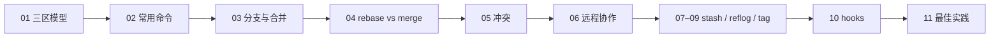

# Git 系统学习 · 课程大纲

> 目标：把日常开发里「会敲几条命令」升级成「清楚三区、分支图、协作与回退」。版本基准：**Git 2.x**（命令以 `switch` / `restore` 为主，必要时注明旧别名）。练习路径统一用 `~/projects/`，勿写本机真实用户路径。

## 学习路线



| 阶段 | 主题 | 你应能回答 |
|------|------|------------|
| 基础 | 三区 + 常用命令 | 改动在工作区还是暂存区？如何只撤暂存？ |
| 主干 | 分支 / merge / rebase / 冲突 | 何时 merge、何时 rebase？冲突标记怎么解？ |
| 协作 | 远程 + stash + 回退 + tag | force-push 何时危险？如何安全回退？ |
| 进阶 | hooks + 实践 | pre-commit 能拦什么？常见坑如何避？ |

## 课程列表

| 编号 | 课程 | 状态 |
|------|------|------|
| 01 | [基础概念：工作区 / 暂存区 / 仓库](01-基础概念-工作区暂存区仓库.md) | ✅ |
| 02 | [常用命令速通](02-常用命令.md) | ✅ |
| 03 | [分支与合并](03-分支与合并.md) | ✅ |
| 04 | [rebase 与 merge 对比](04-rebase与merge对比.md) | ✅ |
| 05 | [冲突处理](05-冲突处理.md) | ✅ |
| 06 | [远程协作](06-远程协作.md) | ✅ |
| 07 | [stash 暂存现场](07-stash.md) | ✅ |
| 08 | [reflog 与回退](08-reflog与回退.md) | ✅ |
| 09 | [tag 标签](09-tag.md) | ✅ |
| 10 | [hooks 概览](10-hooks概览.md) | ✅ |
| 11 | [最佳实践与常见坑](11-最佳实践与常见坑.md) | ✅ |

## 已有专题（本系列不重复展开）

同目录下已有实战向笔记，学完主干后再读：

- [Git Worktree 使用指南](Git%20Worktree%20使用指南.md) — 多工作树并行
- [Git Submodule 使用指南](Git%20Submodule%20使用指南.md) — 子模块引用
- [Fork 项目同步父项目更新](Fork项目同步父项目更新.md) — upstream / origin 同步

## 建议练手

```bash
mkdir -p ~/projects/git-lab && cd ~/projects/git-lab
git init
# 按各章命令逐步操作；练完可整目录删掉重建
```

## 相关说明

本系列同步自个人笔记库的公开白名单；仓库维护方式见根目录 [SYNC.md](../SYNC.md)。
