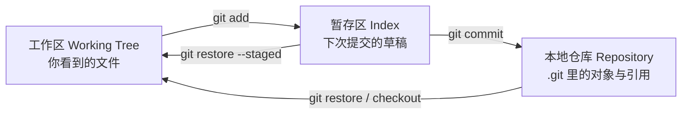

# 01 · 基础概念：工作区 / 暂存区 / 仓库

> 上一篇：[课程大纲](00-课程大纲.md) · 下一篇：[常用命令](02-常用命令.md)

## 1. 为什么要「三区」

很多 VCS 只有「工作目录 ↔ 仓库」。Git 多了一层 **暂存区（Index / Staging Area）**，让你可以：

- 一次改很多文件，但只挑其中几个进下一次提交；
- 同一文件里只提交部分改动（`git add -p`）；
- 把「正在写的草稿」和「准备入库的快照」分开。

不理解三区，就会把 `add` / `commit` / `restore` 当成玄学。

## 2. 三区分别是什么



| 区域 | 物理位置（简化） | 里面有什么 |
|------|------------------|------------|
| **工作区** | 项目目录里除 `.git` 外的文件 | 你正在编辑的内容 |
| **暂存区** | `.git/index` | 「下一笔 commit 应包含的树」的索引 |
| **本地仓库** | `.git/objects` 等 | blob / tree / commit 对象 + refs（分支、tag） |

远程仓库是**另一台机器上的仓库副本**，不属于「三区」，见 [06 远程协作](06-远程协作.md)。

## 3. 四个状态（针对「某个文件」）

相对**上次提交**，一个已跟踪文件常见状态：

| 说法 | 含义 |
|------|------|
| unmodified | 工作区 = 暂存区 = HEAD |
| modified | 工作区有改，还没 `add` |
| staged | 已 `add`，暂存区 ≠ HEAD，等着 `commit` |
| 又改了一次 | 工作区 ≠ 暂存区 ≠ HEAD（很常见） |

未跟踪（untracked）：从未 `add` 过，也不在 `.gitignore` 里时会出现在 `git status`。

## 4. 对象模型（够用版）

一次提交不只是「diff」，而是一棵**快照**：

- **blob**：文件内容（按内容哈希）
- **tree**：目录结构（文件名 → blob/tree）
- **commit**：指向一个 tree + 作者/时间/说明 + 父提交

分支名（如 `main`）只是指向某个 commit 的**可移动指针**。细节在 [03 分支与合并](03-分支与合并.md)。

## 5. `HEAD` 是什么

- 通常：`HEAD` → 当前分支 → 最新 commit
- 游离（detached）：`HEAD` 直接指向某个 commit，不在分支尖上——改完容易「丢」提交，日常开发少用；检 tag、bisect 时常见

```bash
git symbolic-ref HEAD    # 在分支上时：refs/heads/main
git rev-parse HEAD       # 当前 commit 的 SHA
```

## 6. 最小实验

```bash
mkdir -p ~/projects/git-lab && cd ~/projects/git-lab
git init
echo "hello" > app.txt
git status                 # untracked
git add app.txt            # 进暂存区
git status
git commit -m "chore: add app.txt"
echo "hello world" > app.txt
git status                 # modified
git add app.txt
git restore --staged app.txt   # 只撤暂存，工作区改动还在
git restore app.txt            # 工作区回到 HEAD（丢未提交改动，慎用）
```

## 7. 和「保存」的直觉对照

| 你想做的事 | Git 动作 |
|------------|----------|
| 记一笔可回退的版本 | `commit`（需先 `add`） |
| 先勾选哪些进这一笔 | `add` / `add -p` |
| 扔掉工作区未提交改动 | `restore`（不可恢复，慎） |
| 先挪开现场去做别的 | `stash`，见 [07](07-stash.md) |

## 8. 小结

- 三区：**工作区 →（add）→ 暂存区 →（commit）→ 仓库**。
- 暂存区是 Git 的设计核心，不是多余步骤。
- `HEAD`、分支、commit 是指针与快照；搞清指针再学 merge/rebase。

下一篇把日常命令按「看状态 / 改暂存 / 提交 / 查看历史」串起来：[02 常用命令](02-常用命令.md)。
