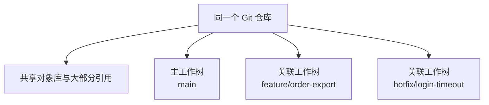

# Git Worktree 使用指南

> 系统学习入口：[Git 系统学习 · 课程大纲](00-课程大纲.md)

> [!abstract] 一句话说明
> Git Worktree 允许同一个 Git 仓库同时拥有多个独立工作目录。每个目录可以检出不同分支，适合并行开发、紧急修复、代码审查和多 Agent 协作。

## 1. 为什么需要 Worktree

假设你正在 `feature/order-export` 分支开发，目录中还有未提交的修改。这时突然需要：

- 切到 `main` 修复线上问题；
- 启动另一个分支的项目进行对比；
- 同时让多个 AI Agent 修改不同功能；
- 在不打断当前工作的情况下审查一个 PR。

传统做法通常是暂存当前修改再切换分支：

```bash
git stash
git switch main
```

这种方式会打断当前环境，切回分支后还可能需要重新安装依赖、重启服务和恢复上下文。

另一种做法是重新克隆仓库，但它会重复保存 Git 对象，拉取和维护成本也更高。

Worktree 提供了第三种选择：**保留当前目录不动，为另一个分支创建新的工作目录。**

```text
~/projects/order-service/              # main
~/projects/order-service-export/       # feature/order-export
~/projects/order-service-hotfix/       # hotfix/login-timeout
```

这些目录对应同一个 Git 仓库，但可以同时打开、编辑、构建和运行。

## 2. Worktree 的核心原理

一个普通 Git 仓库创建完成后，当前目录本身就是主工作树（main worktree）。通过 `git worktree add` 创建的其他目录称为关联工作树（linked worktree）。



### 2.1 共享的内容

- Git 对象，包括 commit、tree 和 blob；
- 分支和标签；
- 提交历史；
- 远程仓库配置；
- 仓库级配置。

因此，在一个 Worktree 中创建的提交或分支，会立即被其他 Worktree 识别，不需要再次 `fetch`。

### 2.2 独立的内容

- 工作目录中的文件；
- 暂存区（index）；
- `HEAD` 和当前检出的分支；
- 未提交修改；
- 每个目录启动的进程和开发服务。

> [!warning] Worktree 不是完整隔离环境
> 它隔离了工作目录和未提交修改，但所有 Worktree 仍共享同一个仓库。删除分支、重写历史或执行危险 Git 操作，仍可能影响其他 Worktree。

### 2.3 一个分支通常只能检出一次

Git 默认不允许同一个本地分支同时被两个 Worktree 检出，目的是避免两个目录同时推进同一个分支而产生混乱。

如果 `feature/order-export` 已在另一个 Worktree 中使用，再次检出会看到类似错误：

```text
fatal: 'feature/order-export' is already checked out at '/path/to/worktree'
```

这时应进入已有 Worktree，或者创建一个新的分支。

## 3. Worktree、切换分支和重新 Clone 的区别

| 方式 | 是否保留当前目录状态 | 是否复用 Git 对象 | 能否同时运行多个分支 | 适用场景 |
| --- | --- | --- | --- | --- |
| `git switch` | 否，需要处理未提交修改 | 是 | 否 | 单任务、快速切换 |
| `git worktree` | 是 | 是 | 是 | 并行开发、修复、审查 |
| 再次 `git clone` | 是 | 通常否 | 是 | 需要完全独立的仓库配置或权限 |

Worktree 的优势是速度快、占用空间小，并且不需要频繁切换分支；代价是多个目录仍然共享仓库状态，需要养成规范的创建和清理习惯。

## 4. 创建 Worktree

以下示例假设主仓库目录是：

```text
~/projects/order-service
```

推荐把关联 Worktree 放在主仓库同级目录，避免嵌套和误提交：

```text
~/projects/
├── order-service/
├── order-service-export/
└── order-service-hotfix/
```

### 4.1 创建新分支并建立 Worktree

最常用的写法：

```bash
git worktree add -b feature/order-export ../order-service-export main
```

参数含义：

| 参数 | 含义 |
| --- | --- |
| `../order-service-export` | 新工作目录的位置 |
| `-b feature/order-export` | 创建并检出的新分支 |
| `main` | 新分支的起点 |

执行完成后进入新目录：

```bash
cd ../order-service-export
git status
```

### 4.2 检出已有本地分支

如果分支已经存在，并且没有被其他 Worktree 使用：

```bash
git worktree add ../order-service-export feature/order-export
```

### 4.3 基于远程分支创建

先获取远程分支，再创建对应的本地分支：

```bash
git fetch origin
git worktree add -b feature/order-export ../order-service-export origin/feature/order-export
```

如果本地不存在同名分支，而且远程分支名称可以被 Git 唯一识别，Git 在部分场景下能够自动建立跟踪关系。为了让行为更清晰，团队协作时建议显式使用 `-b` 和远程起点。

### 4.4 基于指定 Commit 临时查看

只想审查或测试某个提交，不准备直接在分支上开发时，可以使用 detached HEAD：

```bash
git worktree add --detach ../order-service-review a1b2c3d
```

> [!tip]
> detached HEAD 适合只读审查和临时测试。如果后来需要保留修改，请先创建分支：`git switch -c review/fix-suggestion`。

## 5. 查看与定位 Worktree

查看所有 Worktree：

```bash
git worktree list
```

示例输出：

```text
~/projects/order-service          a1b2c3d [main]
~/projects/order-service-export   e4f5g6h [feature/order-export]
~/projects/order-service-review   a1b2c3d (detached HEAD)
```

脚本需要解析结果时，使用稳定的机器可读格式：

```bash
git worktree list --porcelain
```

想知道某个分支当前在哪个 Worktree 中，可以执行：

```bash
git worktree list
git branch -vv
```

`git branch` 输出中，其他 Worktree 正在使用的分支通常会以 `+` 标记。

## 6. 在 Worktree 中开发

进入关联 Worktree 后，日常 Git 操作与普通仓库完全一样：

```bash
cd ../order-service-export

git status
git add .
git commit -m "feat(export): 添加订单导出功能"
git push -u origin feature/order-export
```

提交完成后，主工作树也能立即看到这个分支及其提交：

```bash
cd ../order-service
git log feature/order-export --oneline
```

> [!info] 依赖和本地配置不会自动共享
> `.env`、`node_modules/`、构建产物等被 Git 忽略的文件不会出现在新 Worktree 中。首次进入新目录后，通常需要重新准备环境变量、安装依赖并选择不同的服务端口。

例如：

```bash
cd ../order-service-export
cp .env.example .env
pnpm install
```

不要随意复制包含真实密钥的配置文件；应优先使用配置模板或安全的密钥管理方式。

## 7. 移动 Worktree

需要调整关联 Worktree 的路径时，使用 Git 提供的命令：

```bash
git worktree move ../order-service-export ../worktrees/order-export
```

直接使用文件管理器或 `mv` 移动，可能导致 Git 记录的路径失效。如果目录已经被外部工具移动，可以尝试修复：

```bash
git worktree repair
```

## 8. 锁定 Worktree

如果 Worktree 位于移动硬盘或网络磁盘上，磁盘暂时离线时 Git 可能把它判断为可清理记录。可以先锁定：

```bash
git worktree lock --reason "位于移动硬盘" /path/to/worktree
```

解除锁定：

```bash
git worktree unlock /path/to/worktree
```

普通本地开发目录一般不需要锁定。

## 9. 删除 Worktree

### 9.1 删除前检查

先进入目标 Worktree，确认修改已经提交或不再需要：

```bash
cd ../order-service-export
git status
```

再从其他目录执行删除：

```bash
cd ../order-service
git worktree remove ../order-service-export
```

Git 默认会阻止删除包含未提交修改的 Worktree。

### 9.2 删除对应分支

删除 Worktree 不会自动删除分支。功能已合并且确认不再需要后，可以单独删除：

```bash
git branch -d feature/order-export
```

如果分支尚未合并，`-d` 会拒绝删除。不要为了省事直接改用 `-D`，应先确认提交是否仍需保留。

### 9.3 清理失效记录

如果目录已被手动删除，`git worktree list` 中可能残留 `prunable` 记录。先预览，再清理：

```bash
git worktree prune --dry-run
git worktree prune
```

> [!warning] 不建议直接删除目录
> 优先使用 `git worktree remove <path>`，它会同时清理目录和 Git 的 Worktree 元数据。

## 10. 推荐的完整工作流

下面以紧急修复为例：

```bash
# 1. 在主仓库更新远程信息
cd ~/projects/order-service
git fetch origin

# 2. 从远程主分支创建修复分支和独立目录
git worktree add -b hotfix/login-timeout \
  ../order-service-hotfix \
  origin/main

# 3. 进入新目录开发
cd ../order-service-hotfix
git status

# 4. 安装依赖、修改、测试和提交
pnpm install
git add .
git commit -m "fix(login): 修复登录请求超时"
git push -u origin hotfix/login-timeout

# 5. PR 合并后回到主仓库清理
cd ../order-service
git worktree remove ../order-service-hotfix
git branch -d hotfix/login-timeout
```

整个过程中，原来的开发目录、分支和未提交修改都不需要移动。

## 11. 多任务与多 Agent 协作

Worktree 很适合把不同任务分配到不同目录：

| Worktree | 分支 | 任务 |
| --- | --- | --- |
| `order-service/` | `main` | 主线检查与最终合并 |
| `order-service-api/` | `feature/api` | Agent A 开发接口 |
| `order-service-ui/` | `feature/ui` | Agent B 开发页面 |
| `order-service-review/` | detached HEAD | Agent C 审查指定提交 |

建议遵守以下规则：

1. 一个 Worktree 对应一个明确任务和一个分支。
2. 不同 Worktree 不要监听相同端口。
3. 每个 Agent 只修改自己任务范围内的文件。
4. 各分支先独立测试，再通过合并或 PR 汇总。
5. 任务结束后及时删除 Worktree，避免目录长期堆积。

更多结合 Orca 的使用方式，可参考 Orca 中的 Worktree 协作。

## 12. 常见问题与避坑

### 12.1 新 Worktree 中为什么没有 `.env` 或依赖目录

Worktree 只检出 Git 跟踪的文件。被 `.gitignore` 忽略的本地文件不会自动复制，需要根据项目说明重新生成或安装。

### 12.2 能否在两个 Worktree 中检出同一个分支

Git 默认不允许。应该使用不同分支；即使某些高级参数可以绕过检查，也容易造成两个目录同时修改同一个分支，不建议在常规开发中使用。

### 12.3 在一个 Worktree 中提交，其他目录会变化吗

其他目录中的文件不会自动改变，但共享仓库会立即出现新的 commit 和分支状态。其他 Worktree 是否更新到该提交，取决于其当前分支和后续 merge、rebase 或 reset 操作。

### 12.4 能否在 Worktree 目录中再创建 Worktree

命令可以从任意 Worktree 中执行，但新目录不应放在现有工作树内部。推荐统一放在仓库同级目录或专门的 `worktrees/` 父目录下。

### 12.5 为什么删除目录后列表里还有记录

因为绕过了 `git worktree remove`。使用下面的命令检查并清理：

```bash
git worktree prune --dry-run
git worktree prune
```

### 12.6 Worktree 是否会节省磁盘空间

会复用 Git 对象库，因此通常比再次 clone 更省空间。不过每个工作目录仍有完整的检出文件，依赖目录和构建产物也可能重复占用空间。

## 13. 常用命令速查

| 命令 | 作用 |
| --- | --- |
| `git worktree list` | 查看所有 Worktree |
| `git worktree list --porcelain` | 以机器可读格式查看 |
| `git worktree add <path> <branch>` | 在新目录检出已有分支 |
| `git worktree add -b <new-branch> <path> <start-point>` | 创建新分支和 Worktree |
| `git worktree add --detach <path> <commit>` | 创建 detached HEAD 工作树 |
| `git worktree move <old> <new>` | 移动 Worktree |
| `git worktree remove <path>` | 删除 Worktree |
| `git worktree lock <path>` | 防止 Worktree 记录被清理 |
| `git worktree unlock <path>` | 解除锁定 |
| `git worktree repair` | 修复移动后失效的关联 |
| `git worktree prune --dry-run` | 预览可清理的失效记录 |
| `git worktree prune` | 清理失效记录 |

## 14. 使用建议

适合使用 Worktree：

- 同时开发多个功能；
- 当前工作未完成时处理紧急修复；
- 临时检出 PR、Tag 或 Commit 进行测试；
- 对比不同分支的运行效果；
- 为多个 AI Agent 分配相互隔离的代码目录。

不必使用 Worktree：

- 只是短暂查看另一个分支的少量代码；
- 当前目录没有修改，切换分支不会打断工作；
- 需要完全独立的远程地址、Git 配置或权限；
- 团队没有明确的 Worktree 命名和清理规则。

> [!tip] 推荐约定
> 使用 `<仓库名>-<任务名>` 作为目录名，使用 `feature/`、`fix/`、`hotfix/` 等前缀命名分支。创建前执行 `git worktree list`，合并后执行 `git worktree remove`，能够减少绝大多数管理问题。

## 15. 参考资料

- [Git 官方文档：git-worktree](https://git-scm.com/docs/git-worktree)
- [Pro Git 中文版](https://git-scm.com/book/zh/v2)
- [[Git Submodule 使用指南]]

