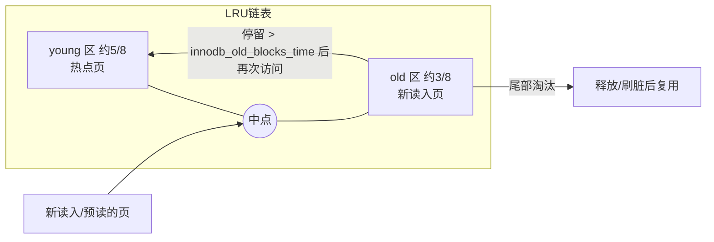

# 01 · 为什么 MySQL 不直接读写磁盘

> 对应摸底题 2｜基准：MySQL 8.0 InnoDB

## 1. 业务场景：秒杀扣库存

```sql
UPDATE stock SET num = num - 1 WHERE sku_id = 1001 AND num > 0;
```

秒杀时同一行每秒可能被更新上千次。如果每次 UPDATE 都要"从磁盘读出这一行 → 修改 → 立刻写回磁盘"，那么吞吐上限就是磁盘随机 IO 能力（机械盘约百级 IOPS，普通 SSD 数万级），远远不够。

## 2. 设计动机

- 内存随机访问约 **100ns** 级；SSD 随机读约 **几十~100μs** 级；机械盘随机读约 **5~10ms**。差距 3~5 个数量级（数量级为经验值）。
- 数据访问有局部性：热点行（如秒杀 SKU）被反复读写。
- 结论：**把数据缓存在内存里读写，磁盘只做"最终持久化"，并且批量、异步地写。** 这就是 Buffer Pool。

## 3. 核心概念

### 3.1 页（Page）
- InnoDB 磁盘与内存交换的最小单位是**页，默认 16KB**（`innodb_page_size`，只能在初始化实例时指定）。
- 即使只读一行，也要把这行所在的整页读进内存。
- 行存放在数据页里，页再组成 B+Tree（第 2 周展开）。

### 3.2 Buffer Pool
- InnoDB 在内存中开辟的大块缓存，以页为单位缓存**数据页、索引页**，还包括 undo 页、change buffer、自适应哈希索引等。
- 读：先查 Buffer Pool，命中直接返回；未命中才从磁盘读页进来。
- 写：直接改 Buffer Pool 中的页。

### 3.3 脏页
- 内存页被修改但还没写回磁盘 → **脏页**（在 flush 链表中跟踪）。
- 修改后不立即落盘，这就带来了"断电会不会丢"的问题 → 下一课 redo log 解决。

### 3.4 后台刷盘
- 由 page cleaner 后台线程把脏页刷回磁盘，触发时机大致有：
  1. redo log 空间快用完，需要推进 checkpoint；
  2. Buffer Pool 空闲页不足，要淘汰脏页先刷盘；
  3. 系统空闲时；
  4. 正常关闭时。
- 相关参数：`innodb_io_capacity`、`innodb_max_dirty_pages_pct`（8.0 默认 90）。
- 刷盘时还有 doublewrite buffer 防止"页写一半"（partial page write），8.0.20 起 doublewrite 有独立文件。


## 4. Buffer Pool 的 LRU：young / old 分区

### 4.1 朴素 LRU 的问题
- **全表扫描**：一条报表 SQL 扫描大表，会把大量"只用一次"的页挤进来，把真正的热点页淘汰。
- **预读**：InnoDB 会预读（线性预读等）可能用到的页，若最终没用上，也污染缓存。

### 4.2 InnoDB 的改进：中点插入（midpoint insertion）
- LRU 链表分成 **new（young）子链** 和 **old 子链**，old 区默认占 **3/8（37%）**，由 `innodb_old_blocks_pct` 控制（取值 5~95）。
- 新读入的页**先插到 old 区头部**（中点），而不是整个链表头部。
- 页在 old 区被再次访问时，只有当它在 old 区停留时间 **超过 `innodb_old_blocks_time`（默认 1000ms）** 才会被移到 young 区。
- 效果：全表扫描在短时间内连续访问同一页，不满足时间条件，留在 old 区并很快被淘汰，热点数据安然留在 young 区。
- 补充：young 区前 1/4 的页被访问时也不会每次都移动，以减少链表操作开销。



## 5. `innodb_buffer_pool_size` 调优

- 8.0 默认 128MB，生产几乎必须调大。
- **数据库专用机：物理内存的 50%~75%**，要给操作系统、连接线程内存（sort/join buffer 等）、其他进程留余量，避免 swap/OOM。
- 8.0 支持在线调整（`SET GLOBAL innodb_buffer_pool_size = ...`），按 `innodb_buffer_pool_chunk_size × innodb_buffer_pool_instances` 的整数倍对齐。
- 若开启 `innodb_dedicated_server=ON`，8.0 会按物理内存自动设置（具体比例因小版本而异，⚠️以官方文档为准）。
- **命中率**：`1 - Innodb_buffer_pool_reads / Innodb_buffer_pool_read_requests`，OLTP 一般期望 > 99%。
- **容器部署**：按容器的 **memory limit** 计算，而不是宿主机内存；否则可能被 cgroup OOM Kill。⚠️ MySQL 对 cgroup 的识别因版本而异，务必显式配置。

## 6. 本地实验

```sql
-- 1. 页大小与 Buffer Pool 配置
SHOW VARIABLES LIKE 'innodb_page_size';
SHOW VARIABLES LIKE 'innodb_buffer_pool%';
SHOW VARIABLES LIKE 'innodb_old_blocks%';

-- 2. 命中率相关计数
SHOW GLOBAL STATUS LIKE 'Innodb_buffer_pool_read%';
SHOW GLOBAL STATUS LIKE 'Innodb_buffer_pool_pages%';   -- total / free / dirty / data

-- 3. 引擎状态：看 BUFFER POOL AND MEMORY 段
--    Buffer pool hit rate、young-making rate、Pages made young / not young
SHOW ENGINE INNODB STATUS\G

-- 4. 结构化统计
SELECT POOL_ID, POOL_SIZE, FREE_BUFFERS, DATABASE_PAGES, OLD_DATABASE_PAGES,
       MODIFIED_DATABASE_PAGES, HIT_RATE, PAGES_MADE_YOUNG, PAGES_NOT_MADE_YOUNG
FROM information_schema.INNODB_BUFFER_POOL_STATS;

-- 5. 观察全表扫描对 young 区的影响：
--    记录 PAGES_MADE_YOUNG / PAGES_NOT_MADE_YOUNG → 对一张大表执行
SELECT COUNT(*) FROM big_table IGNORE INDEX(PRIMARY) WHERE some_col LIKE '%x%';
--    再查一次，应看到 NOT_MADE_YOUNG 明显增长（说明扫描页没进入 young 区）

-- 6. 在线调整（测试环境）
SET GLOBAL innodb_buffer_pool_size = 1024*1024*1024;
SHOW STATUS LIKE 'Innodb_buffer_pool_resize_status';
```

> 提示：`INNODB_BUFFER_POOL_PAGE` 表可查看每一页，但在大实例上查询开销很大，生产勿用。

## 7. 面试题（对应摸底题 2）

**Q1：MySQL 为什么不直接读写磁盘？Buffer Pool 起什么作用？**
> 磁盘随机 IO 比内存慢几个数量级。InnoDB 以 16KB 页为单位把数据缓存在 Buffer Pool：读优先命中内存，写只修改内存页（产生脏页），再由后台线程批量异步刷盘，把大量随机写变成更少、可合并的写。持久性则由 redo log（WAL）保证，而不是依赖每次同步写数据页。

**Q2：一个大表全表扫描会把 Buffer Pool 热点数据冲掉吗？InnoDB 怎么防？**
> 朴素 LRU 会。InnoDB 把 LRU 分成 young/old 两段，新页插入 old 区头部（old 区默认占 37%，`innodb_old_blocks_pct`），只有在 old 区停留超过 `innodb_old_blocks_time`（默认 1s）后再被访问才晋升 young 区。全表扫描的页在 1s 内被连续访问，无法晋升，很快从 old 尾部淘汰，热点数据得以保留；预读未使用的页同理。

## 8. 下一课问题

> 修改只写在内存的脏页里，事务提交后还没刷盘就断电了——**已提交的修改怎么保证不丢？** → [[02-redo-log与两阶段提交]]

## 小结
- 内存比磁盘快几个数量级，InnoDB 用 Buffer Pool 以 16KB 页为单位缓存读写。
- 写操作只改内存产生脏页，由后台线程异步批量刷盘。
- LRU 分 young/old 区 + 停留时间门槛，防全表扫描和预读污染。
- `innodb_buffer_pool_size` 专用机 50%~75%，容器按 limit 算，用命中率评估。

## 自测题
1. InnoDB 默认页大小是多少？能否在线修改？
2. 什么是脏页？哪些情况会触发刷脏？
3. `innodb_old_blocks_pct` 和 `innodb_old_blocks_time` 分别控制什么？
4. 如何计算 Buffer Pool 命中率？
5. 8G 内存的容器中跑 MySQL，buffer pool 设多大合适？为什么不能按宿主机 64G 算？
