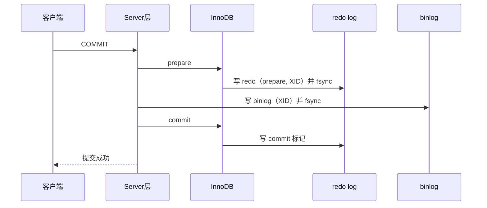

# 02 · redo log 与两阶段提交

> 对应摸底题 1｜基准：MySQL 8.0 InnoDB

## 1. 业务场景：提交成功后宕机

用户下单，`COMMIT` 返回成功，App 显示"支付成功"。下一毫秒机器断电。上一课讲过，修改可能还只在 Buffer Pool 的脏页里。重启后订单还在吗？从库上有没有这笔订单？

## 2. WAL 与 redo log

### 2.1 WAL（Write-Ahead Logging）
- 先写日志，再写数据页。提交时只要**日志落盘**，数据页可以以后再刷。
- 日志是**顺序追加写**，比随机写数据页快得多。

### 2.2 redo log 特点
- **InnoDB 引擎层**的日志。
- **物理日志**：记录"某表空间某页某偏移处做了什么修改"。
- 只用于崩溃恢复：重启时重放 redo，把还没刷盘的脏页修改补回来（crash-safe）。
- **循环写**、大小固定。8.0.30 之前是 `ib_logfile0/1`（`innodb_log_file_size × innodb_log_files_in_group`）；8.0.30 起改为 `#innodb_redo` 目录下的多个文件，由 `innodb_redo_log_capacity` 控制总大小。

### 2.3 write pos 与 checkpoint
- **write pos**：当前写入位置，往前推进。
- **checkpoint**：此位置之前的 redo 对应的脏页已刷盘，空间可复用。
- write pos 追上 checkpoint → redo 满了，必须先刷脏页推进 checkpoint，此时更新会卡顿（生产中的"抖动"来源之一）。


### 2.4 `innodb_flush_log_at_trx_commit`

| 值 | 提交时行为 | 风险 |
|---|---|---|
| **1（默认）** | 每次提交 write + fsync 到磁盘 | 最安全，最慢 |
| 0 | 只写 log buffer，后台约每秒 write+fsync | mysqld 崩溃可丢约 1 秒事务 |
| 2 | 每次提交 write 到 OS page cache，约每秒 fsync | mysqld 崩溃不丢，**OS 崩溃/断电**可丢约 1 秒 |

> 注："每秒"由 `innodb_flush_log_at_timeout`（默认 1）控制，不是严格保证。

## 3. binlog

- **Server 层**日志，所有引擎都可用。
- **逻辑日志**：记录 SQL 语句（STATEMENT）或行变更（ROW，8.0 默认），或 MIXED。
- **追加写**，写满一个文件切换下一个，不覆盖。
- 用途：**主从复制**、**基于时间点的恢复**（全备 + binlog 回放）、CDC（Canal/Debezium）。
- `sync_binlog`：0 = 由 OS 决定刷盘；**1（8.0 默认）** = 每次提交 fsync；N = 每 N 次组提交 fsync。
- "双 1" 配置：`innodb_flush_log_at_trx_commit=1` + `sync_binlog=1`，生产核心库推荐。

## 4. redo log vs binlog

| 维度 | redo log | binlog |
|---|---|---|
| 所属层 | InnoDB 引擎层 | MySQL Server 层 |
| 内容 | 物理日志（页的修改） | 逻辑日志（语句/行变更） |
| 写入方式 | 循环写，固定大小 | 追加写，不覆盖 |
| 主要用途 | 崩溃恢复（crash-safe） | 复制、时间点恢复、CDC |
| 刷盘参数 | innodb_flush_log_at_trx_commit | sync_binlog |
| 能否单独恢复历史数据 | 否（会被覆盖） | 能（配合全备） |

## 5. 两阶段提交（2PC）

一个事务要同时写 redo（引擎层）和 binlog（Server 层），两个日志必须**逻辑一致**。MySQL 用内部 XA 实现：

1. **prepare**：写 redo，标记为 prepare 状态（含 XID），刷盘；
2. **写 binlog**（含同一个 XID），刷盘；
3. **commit**：redo 标记 commit（这一步无需强制 fsync）。



> 实际实现中有 **组提交（group commit）**：多个事务的 redo/binlog fsync 合并进行（flush / sync / commit 三阶段队列），以降低 "双 1" 的开销。

## 6. 如果不做 2PC

以 `UPDATE t SET c=2 WHERE id=1`（原值 c=1）为例：

- **先 redo 后 binlog**：redo 写完、binlog 没写就宕机。重启后主库按 redo 恢复为 c=2；binlog 没这条，从库/用 binlog 恢复的库仍是 c=1 → **主从不一致**。
- **先 binlog 后 redo**：binlog 写完、redo 没写就宕机。主库重启后事务无效，c=1；但 binlog 已有，从库执行后 c=2 → **主从不一致**，用 binlog 恢复的库也比主库"多"一个事务。

## 7. 崩溃恢复判断规则

重启时扫描 redo：
1. redo 中有 **commit** 标记 → 直接提交。
2. redo 只有 **prepare** → 用 XID 去 binlog 查：
   - binlog 中该事务**完整**（有 XID event）→ **提交**；
   - binlog 中不存在或不完整 → **回滚**。

核心原则：**以 binlog 是否完整为准**，保证主库与 binlog（进而从库）一致。

## 8. undo log 简介

- InnoDB 引擎层，**逻辑日志**，记录修改前的旧值（如 UPDATE 记录旧值、INSERT 记录可删除的主键）。
- 作用 1：**事务回滚**（ROLLBACK 或崩溃恢复中回滚未提交事务）。
- 作用 2：**MVCC**：通过行上的 roll pointer 串成版本链，让读视图看到旧版本（详见 [[03-事务隔离级别与MVCC]]）。
- undo 本身的修改也受 redo 保护。8.0 中 undo 存放在独立 undo 表空间（默认 `undo_001`、`undo_002`），由 purge 线程清理：insert undo 提交后即可释放，update undo 要等没有 ReadView 再需要它时才清理（长事务会让它堆积）。

## 9. 实验

```sql
-- 刷盘策略
SHOW VARIABLES LIKE 'innodb_flush_log_at_trx_commit';
SHOW VARIABLES LIKE 'sync_binlog';
SHOW VARIABLES LIKE 'innodb_redo_log_capacity';   -- 8.0.30+
SHOW VARIABLES LIKE 'innodb_log_file_size';       -- 老版本

-- binlog 状态
SHOW VARIABLES LIKE 'log_bin%';
SHOW VARIABLES LIKE 'binlog_format';
SHOW BINARY LOGS;
SHOW MASTER STATUS;   -- 8.0.22+ 也可用 SHOW BINARY LOG STATUS（8.2+）⚠️ 视版本

-- 观察 binlog 里的 XID
CREATE TABLE t (id INT PRIMARY KEY, c INT);
INSERT INTO t VALUES (1, 1);
UPDATE t SET c = 2 WHERE id = 1;
SHOW BINLOG EVENTS IN 'binlog.000001';  -- 找到 Xid 事件 "COMMIT /* xid=... */"

-- redo 相关：LSN 与 checkpoint
SHOW ENGINE INNODB STATUS\G   -- LOG 段：Log sequence number / Last checkpoint at
```

命令行解析 ROW 格式 binlog：
```bash
mysqlbinlog --base64-output=decode-rows -v /path/to/binlog.000001
```

压测对比（可选）：用 sysbench 分别在 `innodb_flush_log_at_trx_commit=1/2`、`sync_binlog=1/0` 下跑写入，观察 TPS 差异。

## 10. 面试题（对应摸底题 1）

**Q1：事务提交成功后宕机，数据为什么不丢？**
> InnoDB 采用 WAL：提交时（`innodb_flush_log_at_trx_commit=1`）redo log 已 fsync 落盘，数据页可以仍是内存中的脏页。重启时从 checkpoint 开始重放 redo，把已提交但未刷盘的修改补回来；未提交的事务用 undo 回滚。

**Q2：redo log 和 binlog 有什么区别？为什么需要两阶段提交？**
> redo 是 InnoDB 的物理日志、循环写、用于崩溃恢复；binlog 是 Server 层逻辑日志、追加写、用于复制和时间点恢复。两份日志分别写，若无原子性保证，任一中间宕机都会使主库（redo 恢复的结果）和 binlog（从库/备份恢复的结果）不一致。2PC 先 redo prepare，再写 binlog，最后 commit；恢复时 prepare 状态的事务按 XID 查 binlog，完整则提交，否则回滚，从而保证两者一致。

## 11. 下一课预告

> 数据页在 Buffer Pool 里，但一张千万行的表，InnoDB 是怎么在几次 IO 内找到一行的？→ **第 2 周：索引的 B+Tree 结构**

## 小结
- WAL：先顺序写 redo，再异步刷数据页，提交只需 redo 落盘即可 crash-safe。
- redo：引擎层物理日志、循环写（write pos / checkpoint）；binlog：Server 层逻辑日志、追加写，用于复制与恢复。
- "双 1"（`innodb_flush_log_at_trx_commit=1`、`sync_binlog=1`）是最安全的配置。
- 两阶段提交 prepare → binlog → commit；恢复看 XID 在 binlog 中是否完整。
- undo log 负责回滚和 MVCC 版本链。

## 自测题
1. `innodb_flush_log_at_trx_commit` 取 0/1/2 时，mysqld 崩溃和 OS 断电分别会丢数据吗？
2. write pos 追上 checkpoint 会发生什么？
3. 为什么不能只用 binlog 做崩溃恢复？
4. 画出两阶段提交时序，并说明在 binlog 写完、commit 之前宕机，恢复后事务是提交还是回滚？
5. undo log 和 redo log 分别解决什么问题？
