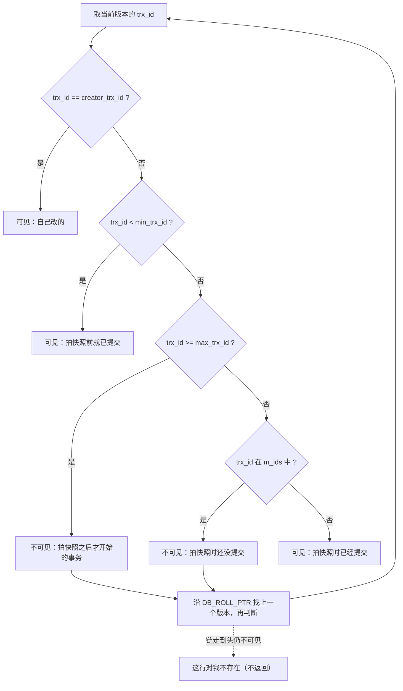
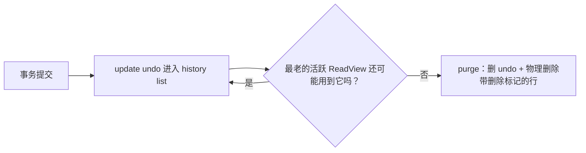

# 03 · 事务隔离级别与 MVCC

> 这一篇把原来散在 [[02-redo-log与两阶段提交]]（undo 简介）和 《MySQL 高频面试题》系列（Q5 隔离级别、Q6 MVCC、Q7 锁）里的内容收拢成一条主线。**以后这块内容以本篇为准**。
> 版本基准：**MySQL 8.0 + InnoDB**。⚠️ 表示细节和版本或实现有关，面试时先说前提。

主线一句话：**并发会产生读异常 → 用隔离级别定义“允许哪些异常” → 加锁太慢，所以 InnoDB 用 MVCC 让读不加锁 → MVCC = 隐藏列 + undo 版本链 + ReadView → RC/RR 的差别只在 ReadView 什么时候生成 → MVCC 管不了“当前读”，那部分靠锁 → 旧版本要靠 purge 回收，长事务会拖垮它。**


---

## 1. 业务场景：并发会出什么问题

先建两张表，后文例子都用它们：

```sql
CREATE TABLE account (
  id      INT PRIMARY KEY,
  name    VARCHAR(20),
  balance INT NOT NULL
) ENGINE=InnoDB;
INSERT INTO account VALUES (1,'张三',1000),(2,'李四',1000);

CREATE TABLE stock (
  id     INT PRIMARY KEY,
  sku    VARCHAR(20),
  qty    INT NOT NULL,
  KEY idx_qty (qty)
) ENGINE=InnoDB;
INSERT INTO stock VALUES (10,'iPhone',5),(20,'iPad',0),(30,'Mac',8);
```

Java 里类比：两个线程同时操作一个没加锁的 `HashMap`，你会看到“半截状态”。数据库的事务就是在解决“别的事务的半截状态我能不能看到”。

### 1.1 脏读：读到别人**还没提交**的数据

| 时间 | 事务 A（转账：张三转出 500） | 事务 B（风控查询余额） |
|---|---|---|
| t1 | `BEGIN;` | |
| t2 | `UPDATE account SET balance=500 WHERE id=1;` | |
| t3 | | `BEGIN; SELECT balance FROM account WHERE id=1;` → **500** |
| t4 | `ROLLBACK;`（转账失败） | |
| t5 | | 按 500 做了风控判断，但真实余额一直是 1000 |

B 用了一个“从来没存在过”的值。

### 1.2 不可重复读：同一事务里**同一行**读两次，值变了

| 时间 | 事务 A（生成对账单） | 事务 B（扣库存） |
|---|---|---|
| t1 | `BEGIN; SELECT qty FROM stock WHERE id=10;` → 5 | |
| t2 | | `UPDATE stock SET qty=4 WHERE id=10; COMMIT;` |
| t3 | `SELECT qty FROM stock WHERE id=10;` → **4** | |

B 的修改是**已提交**的，不算脏；问题是 A 在一个事务里看到了两个不同的世界，对账单前后不一致。关键词：**UPDATE / DELETE 同一行**。

### 1.3 幻读：同一事务里按**范围/条件**查两次，行数变了

| 时间 | 事务 A（统计有货商品） | 事务 B（新品上架） |
|---|---|---|
| t1 | `BEGIN; SELECT COUNT(*) FROM stock WHERE qty>0;` → 2 | |
| t2 | | `INSERT INTO stock VALUES (40,'Watch',3); COMMIT;` |
| t3 | `SELECT COUNT(*) FROM stock WHERE qty>0;` → **3** | |

多出来的那一行像“幻影”。关键词：**INSERT 进了我的查询范围**（每一行本身都没被改过，是集合变了）。

> 区分口诀：**不可重复读看“一行的值”，幻读看“一个范围的行数”**。

---

## 2. 四种隔离级别

SQL 标准用“允许哪些异常”来定义隔离级别：

| 隔离级别 | 脏读 | 不可重复读 | 幻读 | InnoDB 的主要实现 |
|---|---|---|---|---|
| READ UNCOMMITTED（RU） | 可能 | 可能 | 可能 | 读直接读最新版本，不用 ReadView |
| READ COMMITTED（RC） | ✘ | 可能 | 可能 | 每条 SELECT 新建 ReadView；加锁基本只锁记录 |
| REPEATABLE READ（RR，**默认**） | ✘ | ✘ | **快照读 ✘；当前读靠临键锁 ✘；⚠️ 混用时仍可能出现，见第 7 节** | 事务内复用第一个 ReadView；当前读加临键锁 |
| SERIALIZABLE | ✘ | ✘ | ✘ | ⚠️ 关闭 autocommit 时，普通 SELECT 隐式变成 `SELECT ... FOR SHARE`，靠锁串行化冲突 |

```sql
SELECT @@transaction_isolation;                          -- 8.0 用这个（tx_isolation 已移除）
SET SESSION TRANSACTION ISOLATION LEVEL READ COMMITTED;   -- 当前会话
SET GLOBAL  TRANSACTION ISOLATION LEVEL REPEATABLE READ;  -- 新连接生效
```

注意：SQL 标准里 RR **允许**幻读，InnoDB 的 RR 比标准更强（靠 MVCC + 临键锁），但**不是 100%**。

### 2.1 为什么 MySQL 默认 RR

- 历史原因：早期 binlog 只有 STATEMENT 格式，RC 下主库并发执行的语句顺序和 binlog 记录顺序可能对不上，从库重放结果不同。RR + 间隙锁能阻止“范围内插入”，让 statement 复制安全。⚠️ 现在 8.0 默认 `binlog_format=ROW`，这个理由已经弱化；而且 InnoDB 下 RC 不允许配 STATEMENT 格式的 binlog。
- 兼容性：默认值一直没改，大量老系统依赖它。

### 2.2 为什么很多互联网公司用 RC

- **锁更少**：RC 下基本不加间隙锁（外键、唯一性检查等除外），死锁和锁等待明显减少，高并发写更友好。
- **UPDATE 不命中行就早放锁**：RC 下扫描到不满足 WHERE 的行会释放锁，而 RR 会一直持有到事务结束。⚠️ 另有“半一致读”（semi-consistent read）优化。
- **业务不需要可重复读**：大多数接口是“一个短事务干一件事”，不会在一个事务里重复读同一数据；真需要强一致的地方用 `SELECT ... FOR UPDATE` 或乐观锁（`version` 列）解决。
- 用 ROW 格式 binlog，RC 也不会主从不一致。
- 和 Oracle、PostgreSQL 等默认 RC 一致，迁移和团队认知成本低。

---

## 3. 为什么需要 MVCC

最朴素的隔离办法是加锁：读加共享锁、写加排他锁。问题是**读写互斥**——一个慢报表 SELECT 会把所有写挡住，一次大 UPDATE 也会让所有查询排队。

MVCC（多版本并发控制）的思路：**写的时候别覆盖旧值，而是保留旧版本；读的人按自己的“快照时间点”去挑一个该看的版本。**

- 读不加锁，写也不等读 → **读写不互斥**（写写仍然互斥，靠行锁）。
- Java 类比：`CopyOnWriteArrayList` 的读线程拿着旧数组迭代，写线程复制出新数组——读写互不阻塞。MVCC 是“行级、带时间点”的类似思想，只是旧版本不是整份复制，而是存在 undo log 里按需还原。

MVCC 只在 **RC 和 RR** 下工作（RU 直接读最新，SERIALIZABLE 主要靠锁）。

---

## 4. MVCC 三件套

### 4.1 隐藏列

InnoDB 聚簇索引的每一行，除了你定义的列，还有：

| 隐藏列 | 大小 | 含义 |
|---|---|---|
| `DB_TRX_ID` | 6 字节 | **最后一次修改**这一行的事务 ID（INSERT / UPDATE；DELETE 在 InnoDB 里也是一次“打删除标记”的更新） |
| `DB_ROLL_PTR` | 7 字节 | 回滚指针，指向这一行**上一个版本**所在的 undo log 记录 |
| `DB_ROW_ID` | 6 字节 | 只有表没有主键也没有非空唯一索引时才用作隐式主键，和 MVCC 无关 |

事务 ID 是全局递增的。⚠️ 只读事务（没写过数据）不会分配真正的事务 ID，InnoDB 只在事务第一次修改数据（或加锁读等）时分配；所以 `INNODB_TRX` 里只读事务显示的 `trx_id` 是一个很大的临时数字。

### 4.2 undo 版本链

每次修改一行：

1. 先把**修改前的旧值**写一条 undo 记录（undo 本身的写入也受 redo 保护，见 [[02-redo-log与两阶段提交]]）；
2. 在数据页上原地改成新值，`DB_TRX_ID` = 当前事务 ID，`DB_ROLL_PTR` 指向刚写的 undo 记录。

多次修改后，就形成一条从新到旧的链：


要点：
- 链头永远是数据页上的**最新**版本（哪怕还没提交）。
- undo 有两类：**insert undo**（INSERT 产生，事务提交后就没人需要了，可以直接丢）和 **update undo**（UPDATE/DELETE 产生，提交后还可能被别人的快照读用到，要等 purge）。
- 读旧版本 = 从链头开始，逐个“倒放” undo，直到找到可见版本——这有成本，链越长越慢。

### 4.3 ReadView（读视图）

ReadView 是快照读那一刻拍下的“谁已提交、谁还没提交”的名单：

| 字段 | 含义 | 易错点 |
|---|---|---|
| `m_ids` | 生成 ReadView 时**活跃（已开始未提交）**的读写事务 ID 列表 | 不含自己 ⚠️（实现上自己的 ID 单独记在 creator） |
| `min_trx_id` | `m_ids` 里的最小值（`m_ids` 为空时等于 `max_trx_id`） | |
| `max_trx_id` | 生成时系统**下一个将要分配**的事务 ID | **不是** `m_ids` 的最大值 |
| `creator_trx_id` | 生成这个 ReadView 的事务自己的 ID（只读事务为 0） | |

⚠️ 源码里对应 `m_ids / m_up_limit_id / m_low_limit_id / m_creator_trx_id`，命名正好“高低反着”，看源码时别被绕晕；面试用上表的叫法即可。

### 4.4 可见性判断算法

对版本链上的某个版本，拿它的 `trx_id` 去问 ReadView：



找到可见版本后，如果它带删除标记，说明在我的快照里这一行已被删，也不返回。

### 4.5 完整推演例子

初始：`account id=1, balance=1000`，由已提交的事务 100 插入。系统下一个事务 ID 为 200。

| 时间 | 事务 200 | 事务 300 | 事务 400（只读，查余额） |
|---|---|---|---|
| t1 | `BEGIN; UPDATE ... balance=800 WHERE id=1;` | | |
| t2 | | `BEGIN; UPDATE account SET name='张' WHERE id=2;`（只为拿到 ID） | |
| t3 | `COMMIT;` | | |
| t4 | | `UPDATE ... balance=700 WHERE id=1;`（未提交） | |
| t5 | | | `BEGIN; SELECT balance FROM account WHERE id=1;` |

t5 时 400 生成 ReadView（假设下一个待分配 ID 是 401；400 只读所以 creator=0）：
- `m_ids = [300]`（200 已提交）
- `min_trx_id = 300`，`max_trx_id = 401`，`creator_trx_id = 0`

版本链：`700(trx 300) → 800(trx 200) → 1000(trx 100)`

1. 版本 700，trx_id=300：≠0；不 <300；不 ≥401；在 m_ids 中 → **不可见**，顺链往下。
2. 版本 800，trx_id=200：200 < min_trx_id(300) → **可见**。

结果：**读到 800**——正好是“已提交的最新值”，既没看到 300 的未提交修改（无脏读），也不用等 300 的行锁（读写不互斥）。

（这里用数字示意。真实 ID 不连续，且只读事务的 ID 是大数，不影响算法。）

---

## 5. RC 和 RR 的差别 = ReadView 的生成时机

| | RC | RR |
|---|---|---|
| 何时生成 ReadView | **每一条**快照读 SELECT 都重新生成 | 事务里**第一条**快照读时生成，之后一直复用 |
| 效果 | 每次都能看到“最新已提交” | 整个事务看到同一个时间点的快照 |

例子（初始 `qty=5`）：

| 时间 | 事务 A | 事务 B（trx_id=500） |
|---|---|---|
| t1 | `BEGIN; SELECT qty FROM stock WHERE id=10;` → 5 | |
| t2 | | `BEGIN; UPDATE stock SET qty=4 WHERE id=10; COMMIT;` |
| t3 | `SELECT qty FROM stock WHERE id=10;` → ? | |

- **RC**：t3 新生成 ReadView，此时 500 已提交，不在 `m_ids` 中且 < `max_trx_id` → 读到 **4**（不可重复读）。
- **RR**：t3 复用 t1 的 ReadView，当时 500 还没开始，500 ≥ 当时的 `max_trx_id` → 不可见，顺链读到 **5**。

两个容易问到的细节：
- `BEGIN` / `START TRANSACTION` **不会**立刻生成 ReadView，第一条快照读才生成；想立刻拍快照用 `START TRANSACTION WITH CONSISTENT SNAPSHOT`（只对 RR 有意义）。所以 RR 的“快照时间点”是**第一条 SELECT 的时刻**，不是 BEGIN 的时刻。
- 自己改的永远看得到（规则 1），不论 RC 还是 RR。

---

## 6. 快照读 vs 当前读

| | 快照读（consistent read） | 当前读（locking read） |
|---|---|---|
| 语句 | 普通 `SELECT` | `SELECT ... FOR UPDATE`、`SELECT ... FOR SHARE`（旧写法 `LOCK IN SHARE MODE`）、`UPDATE`、`DELETE`、`INSERT` |
| 读哪个版本 | ReadView 可见的版本（可能是旧版本） | **最新版本**（若最新版本被别人未提交地改着，就等它的锁） |
| 加锁 | 不加锁 | 加行锁（RR 下通常是临键锁） |
| 靠什么隔离 | MVCC | 锁 |

为什么写操作必须是当前读？想象 RR 下两个事务都基于快照里的 `qty=5` 各扣 1 再写回，最后是 4 而不是 3——丢失更新。所以 `UPDATE stock SET qty=qty-1` 一定是在最新值上做的。

Java 后端常见坑：
```sql
-- ❌ 先快照读再根据结果写，并发下会超卖
SELECT qty FROM stock WHERE id=10;            -- 读到 1
UPDATE stock SET qty=0 WHERE id=10;            -- 应用层算出来的值
-- ✅ 要么当前读加锁
SELECT qty FROM stock WHERE id=10 FOR UPDATE;
-- ✅ 要么把条件写进 UPDATE（原子扣减）
UPDATE stock SET qty=qty-1 WHERE id=10 AND qty>=1;   -- 看 affected rows
```

---

## 7. RR 下的幻读：MVCC + 锁分工

### 7.1 快照读的幻读：MVCC 解决

第 1.3 节的例子放到 RR：A 第二次 `COUNT(*)` 复用第一次的 ReadView，B 插入的新行 trx_id 不可见 → 仍是 2。**没有幻读。**

### 7.2 当前读的幻读：临键锁 / 间隙锁解决

当前读要读最新数据，MVCC 帮不上忙，只能**不让别人插进来**：

| 时间 | 事务 A（RR） | 事务 B |
|---|---|---|
| t1 | `BEGIN; SELECT * FROM stock WHERE qty>5 FOR UPDATE;` | |
| t2 | | `INSERT INTO stock VALUES (40,'Watch',9);` → **阻塞** |
| t3 | `SELECT * FROM stock WHERE qty>5 FOR UPDATE;` → 结果不变 | |
| t4 | `COMMIT;` | 插入成功 |

A 在 `idx_qty` 上对扫描到的范围加了**临键锁**（记录锁 + 它前面的间隙，左开右闭），一直到正无穷（supremum），B 想往这个范围插入需要的“插入意向锁”与间隙锁冲突，只能等。锁的细节放到 《MySQL 高频面试题》系列 Q7 / 后续“行锁、间隙锁、临键锁与死锁”一课。

### 7.3 为什么 RR 仍不能完全避免幻读（反例）

问题出在**同一个事务里快照读和当前读混用**：

| 时间 | 事务 A（RR） | 事务 B |
|---|---|---|
| t1 | `BEGIN; SELECT * FROM stock WHERE id=40;` → 空（ReadView 已生成） | |
| t2 | | `INSERT INTO stock VALUES (40,'Watch',3); COMMIT;` |
| t3 | `SELECT * FROM stock WHERE id=40;` → 仍为空（快照读，MVCC 生效） | |
| t4 | `UPDATE stock SET qty=10 WHERE id=40;` → **影响 1 行**（当前读看到了 B 的新行） | |
| t5 | `SELECT * FROM stock WHERE id=40;` → **出现了 id=40 的行**！ | |

原因：t4 的 UPDATE 是当前读，改了这行后 `DB_TRX_ID` 变成 A 自己的 ID；t5 快照读按规则 1“自己改的可见”，于是这行“冒出来”了。

另一种更简单的形式：t1 先普通 `SELECT COUNT(*)` 得到 2，B 插入并提交，A 再 `SELECT COUNT(*) ... FOR UPDATE` 得到 3——同一事务里两种读看到的结果不同。

**规避**：需要“读完再根据结果写”的场景，一开始就用当前读（`FOR UPDATE`）把范围锁住；或者用唯一约束 / 乐观锁兜底；真要求绝对串行用 SERIALIZABLE。

---

## 8. undo 何时可清理：purge 与长事务

### 8.1 谁能删、什么时候删

- **insert undo**：只用于回滚。事务提交后别人不可能需要“插入前的版本”（插入前这行不存在），可立即释放。
- **update undo**：提交后还可能被**其他事务的 ReadView** 用来还原旧版本。只有当系统里**所有活跃 ReadView 都不再需要**它（即比最老的那个 ReadView 还“老”）时，才能清理。
- 清理由后台 **purge 线程**完成（`innodb_purge_threads`，⚠️ 8.0 默认 4）。purge 同时负责把 DELETE 打了删除标记的记录**真正物理删除**——所以 DELETE 不是马上腾出空间。
- 已提交、等待 purge 的 undo 数量就是 **history list length**（`SHOW ENGINE INNODB STATUS` 的 TRANSACTIONS 段）。



8.0 的 undo 放在独立 undo 表空间（默认 `undo_001`、`undo_002`），开启 `innodb_undo_log_truncate`（⚠️ 8.0 默认 ON）后，超过 `innodb_max_undo_log_size` 的 undo 表空间可以被截断回收。

### 8.2 长事务的危害

一个 RR 事务开了 ReadView 不提交（比如 Java 里 `@Transactional` 方法中调了一个 30 秒的 RPC，或 IDE 里开了事务忘了提交），会导致：

1. **undo 无法 purge**：这之后所有更新的旧版本都得留着，history list length 一路上涨，undo 表空间膨胀。
2. **查询变慢**：别的快照读可能要沿很长的版本链倒放；被删的行迟迟不物理删除，扫描要跳过大量删除标记记录。
3. **锁长期持有**：长事务里做过当前读/写，锁要到提交才释放，引发大面积锁等待甚至死锁。
4. **主从延迟与回滚代价**：大事务 binlog 一次性写入，从库重放慢；真要回滚，回滚时间可能和执行时间一样长。

排查与治理：
```sql
-- 运行超过 60 秒的事务
SELECT trx_id, trx_state, trx_started, trx_mysql_thread_id, trx_query,
       TIMESTAMPDIFF(SECOND, trx_started, NOW()) AS seconds
FROM information_schema.INNODB_TRX
WHERE TIMESTAMPDIFF(SECOND, trx_started, NOW()) > 60
ORDER BY trx_started;

-- 必要时干掉对应连接
-- KILL <trx_mysql_thread_id>;
```
- 应用侧：事务里不做 RPC/远程 IO；拆小批量；只读查询不要包在事务里（或用只读事务）；连接池 `autocommit` 保持默认 true。
- 监控 history list length 和长事务时长报警。

---

## 9. 动手实验

准备：同一个库开**两个**客户端窗口，记为会话 1、会话 2；先执行第 1 节的建表语句。每组实验前重置数据：

```sql
UPDATE stock SET qty=5 WHERE id=10;
DELETE FROM stock WHERE id>=40;
```

### 9.1 RC 组：看到不可重复读和幻读

| 步骤 | 会话 1 | 会话 2 |
|---|---|---|
| 1 | `SET SESSION TRANSACTION ISOLATION LEVEL READ COMMITTED;` | `SET SESSION TRANSACTION ISOLATION LEVEL READ COMMITTED;` |
| 2 | `BEGIN;` | |
| 3 | `SELECT qty FROM stock WHERE id=10;` → 5 | |
| 4 | `SELECT COUNT(*) FROM stock WHERE qty>0;` → 2 | |
| 5 | | `UPDATE stock SET qty=4 WHERE id=10;`（autocommit，立即提交） |
| 6 | | `INSERT INTO stock VALUES (40,'Watch',3);` |
| 7 | `SELECT qty FROM stock WHERE id=10;` → **4**（不可重复读） | |
| 8 | `SELECT COUNT(*) FROM stock WHERE qty>0;` → **3**（幻读） | |
| 9 | `COMMIT;` | |

再加一步验证“无脏读”：会话 2 `BEGIN; UPDATE stock SET qty=99 WHERE id=10;` 不提交，会话 1 查询仍是 4；会话 2 `ROLLBACK;`。

### 9.2 RR 组：快照不变 + 幻读反例

先重置数据。

| 步骤 | 会话 1 | 会话 2 |
|---|---|---|
| 1 | `SET SESSION TRANSACTION ISOLATION LEVEL REPEATABLE READ;` | `SET SESSION TRANSACTION ISOLATION LEVEL REPEATABLE READ;` |
| 2 | `BEGIN;` | |
| 3 | `SELECT qty FROM stock WHERE id=10;` → 5（此刻生成 ReadView） | |
| 4 | `SELECT * FROM stock WHERE id=40;` → 空 | |
| 5 | | `UPDATE stock SET qty=4 WHERE id=10;` |
| 6 | | `INSERT INTO stock VALUES (40,'Watch',3);` |
| 7 | `SELECT qty FROM stock WHERE id=10;` → **5**（可重复读） | |
| 8 | `SELECT qty FROM stock WHERE id=10 FOR UPDATE;` → **4**（当前读看最新） | |
| 9 | `SELECT * FROM stock WHERE id=40;` → 空 | |
| 10 | `UPDATE stock SET qty=10 WHERE id=40;` → Rows matched: **1** | |
| 11 | `SELECT * FROM stock WHERE id=40;` → **出现一行**（第 7.3 节的幻读反例） | |
| 12 | `ROLLBACK;` | |

### 9.3 RR 组：观察间隙锁阻塞插入

| 步骤 | 会话 1 | 会话 2 |
|---|---|---|
| 1 | `BEGIN; SELECT * FROM stock WHERE qty>5 FOR UPDATE;` | |
| 2 | | `BEGIN; INSERT INTO stock VALUES (50,'TV',9);` → 阻塞 |
| 3 | 在**第三个窗口**执行下面的观察 SQL | |
| 4 | `COMMIT;` | 插入完成，`ROLLBACK;` 清理 |

> 改成 RC 重做 9.3，会话 2 的插入不会被阻塞——这就是“RC 锁少”的直观体现。

### 9.4 观察：INNODB_TRX 与 data_locks

```sql
-- 当前活跃事务：状态、开始时间、隔离级别、锁数量
SELECT trx_id, trx_state, trx_started, trx_isolation_level,
       trx_rows_locked, trx_lock_structs, trx_mysql_thread_id, trx_query
FROM information_schema.INNODB_TRX;

-- 当前持有/等待的锁（8.0 起取代 information_schema.INNODB_LOCKS）
SELECT engine_transaction_id AS trx, object_name, index_name,
       lock_type, lock_mode, lock_status, lock_data
FROM performance_schema.data_locks;

-- 谁在等谁
SELECT * FROM performance_schema.data_lock_waits;
SELECT * FROM sys.innodb_lock_waits\G

-- undo 堆积情况：看 TRANSACTIONS 段的 History list length
SHOW ENGINE INNODB STATUS\G
```

读 `data_locks.lock_mode` 的小抄（⚠️ 以实际输出为准）：
- `IX`：表级意向排他锁
- `X`：临键锁（记录 + 前面的间隙）
- `X,REC_NOT_GAP`：只锁记录
- `X,GAP`：只锁间隙
- `X,INSERT_INTENTION`：插入意向锁（9.3 里会话 2 处于 `WAITING` 的就是它）
- `lock_data = supremum pseudo-record`：锁到了“正无穷”那个间隙

在 9.1 / 9.2 里只做普通 SELECT 的会话，`INNODB_TRX` 能看到事务，但 `data_locks` 里没有它的行锁——**快照读不加锁**的直接证据。

---

## 10. 常见误区

- ❌ “MVCC 解决了幻读” → 只解决**快照读**的幻读；当前读靠临键锁；两者混用仍可能出现（7.3）。
- ❌ “RR 的快照在 BEGIN 时拍” → 在第一条快照读时拍；`WITH CONSISTENT SNAPSHOT` 才是立即。
- ❌ “`max_trx_id` 是活跃事务里最大的 ID” → 是**下一个将分配**的 ID。
- ❌ “`trx_id < max_trx_id` 就可见” → 还要检查是否在 `m_ids` 里。
- ❌ “RC 和 RR 的区别是 RC 不用 MVCC” → 都用 MVCC，区别只在 ReadView 生成时机（以及加锁范围）。
- ❌ “UPDATE 也是读快照” → UPDATE/DELETE/INSERT 都是当前读，否则会丢失更新。
- ❌ “MVCC 下读写写都不冲突” → 读写不冲突，**写写仍互斥**（行锁）。
- ❌ “DELETE 立刻物理删除” → 先打删除标记，purge 后才真正删除。
- ❌ “事务提交了 undo 就删了” → insert undo 可以；update undo 要等没有 ReadView 需要它。
- ❌ “SERIALIZABLE 就是单线程执行” → 是把普通读变成加共享锁的读，冲突的事务才串行，不冲突的仍并发。
- ❌ “不可重复读和幻读是一回事” → 前者是一行的值变了，后者是范围里的行数变了。

## 11. 小结

1. 三种读异常：脏读（读未提交）、不可重复读（同一行值变）、幻读（范围行数变）。
2. 隔离级别 RU/RC/RR/S；MySQL 默认 RR（历史上为 statement 复制安全），互联网常用 RC（锁少、死锁少、够用）。
3. MVCC 让快照读不加锁，实现**读写不互斥**。
4. 三件套：隐藏列 `DB_TRX_ID`/`DB_ROLL_PTR` + undo 版本链 + ReadView（`m_ids`、`min_trx_id`、`max_trx_id`、`creator_trx_id`）。
5. 可见性：自己改的可见 → 比最小活跃还小可见 → ≥ 下一个待分配不可见 → 中间看在不在 `m_ids`；不可见就顺链往回找。
6. RC 每条 SELECT 新建 ReadView，RR 复用第一次的 ReadView。
7. 快照读靠 MVCC，当前读靠锁；RR 下两者混用仍会幻读。
8. update undo 要等最老 ReadView 不再需要才 purge；长事务 = undo 膨胀 + 版本链变长 + 锁长期持有。

## 12. 自测题

1. 用一句话分别说出脏读、不可重复读、幻读的区别。
2. ReadView 的 `max_trx_id` 是什么？为什么不能用 `m_ids` 的最大值代替？
3. 第 4.5 节的例子里，如果事务 400 在 t2 和 t3 之间（200 提交前）就做了 SELECT，在 RR 下 t5 再查会读到多少？在 RC 下呢？
4. RR 下 `BEGIN` 之后过了 10 秒才执行第一条 SELECT，这 10 秒里别的事务提交的修改能看到吗？
5. 为什么 UPDATE 必须是当前读？举一个如果用快照读会出错的例子。
6. 写出一个 RR 下出现幻读的时间线，并说明怎么避免。
7. 为什么 insert undo 提交后就能删，而 update undo 不行？
8. 线上 history list length 持续上涨，你会怎么排查？
9. 同样执行 `SELECT * FROM stock WHERE qty>5 FOR UPDATE`，RC 和 RR 下对另一个会话的 INSERT 影响有什么不同？

### 参考答案

1. 脏读读到别人**未提交**的数据；不可重复读是同一事务内**同一行**两次读到不同的已提交值；幻读是同一事务内**同一范围**两次查询行数不同（有新插入/删除）。
2. 是生成 ReadView 时系统下一个将要分配的事务 ID。`m_ids` 只记录“当时还活跃”的事务：如果拿它的最大值当上界，那些 ID 比它大、但在拍快照之前就已开始并提交的事务，以及拍快照之后才开始的事务就无法区分。用“下一个待分配 ID”做上界，才能把“快照之后才出现的事务”一刀切成不可见；`m_ids` 为空时也照样能判断。
3. 那时 `m_ids=[200]`（若 300 已开始则为 [200,300]），版本 800（trx 200）不可见，顺链得 1000。RR 下 t5 复用该 ReadView → **1000**；RC 下 t5 新建 ReadView（m_ids=[300]）→ **800**。
4. 能。RR 的 ReadView 在第一条快照读时才生成，10 秒内提交的修改都早于快照。若想在 BEGIN 时就定格，用 `START TRANSACTION WITH CONSISTENT SNAPSHOT`。
5. 写必须基于最新值，否则丢失更新。例：两个事务都在快照里看到 qty=5，各自执行“读出来减 1 写回 4”，结果是 4 而不是 3。InnoDB 的 `UPDATE ... SET qty=qty-1` 读最新版本并加行锁，第二个事务会等第一个提交后在 4 的基础上减成 3。
6. 见 7.3：A 快照读 id=40 为空 → B 插入 id=40 提交 → A `UPDATE ... WHERE id=40` 影响 1 行 → A 再快照读看到 id=40。避免：需要据读结果写时，一开始就 `SELECT ... FOR UPDATE` 锁住范围；或依赖唯一约束/乐观锁；或用 SERIALIZABLE。
7. insert undo 记录的是“插入前这行不存在”，其他事务的快照如果不该看到这行，直接判定不可见即可，不需要从 undo 还原任何旧值，所以只为回滚服务，提交即可释放；update undo 保存了旧值，任何比本次修改更早的 ReadView 都可能要靠它还原，必须等这些 ReadView 都结束。
8. 先查 `INNODB_TRX` 按 `trx_started` 排序找长事务及其线程/SQL，结合 `performance_schema.threads`/processlist 定位来源应用；确认后提交或 `KILL`；再看 purge 是否跟不上（写入过猛、`innodb_purge_threads`）；长期治理是应用侧缩短事务并加长事务监控告警。
9. RR 下对 `idx_qty` 扫描范围加临键锁直至 supremum，其他会话插入 qty>5 的行会被阻塞；RC 下基本只锁命中的记录，不锁间隙，插入不阻塞（所以 RC 下当前读也可能幻读）。

## 13. 面试一句话回答模板

- **隔离级别**：“RU/RC/RR/Serializable 依次解决脏读、不可重复读、幻读。MySQL 默认 RR，主要是历史上为 statement 格式 binlog 主从一致；互联网常改 RC，因为几乎没有间隙锁，死锁少，配合 ROW binlog 没有复制问题。”
- **MVCC 原理**：“每行有隐藏列 `DB_TRX_ID` 和 `DB_ROLL_PTR`，旧版本存在 undo 里串成版本链；快照读时生成 ReadView，记录活跃事务列表 `m_ids`、最小活跃 ID、下一个待分配 ID 和自己的 ID，沿版本链找到第一个可见版本，所以普通读不加锁，读写不互斥。”
- **RC vs RR**：“两者都用 MVCC，区别是 ReadView 生成时机：RC 每条 SELECT 都新建，所以能读到最新提交；RR 在事务第一次快照读时生成并复用，所以可重复读。”
- **RR 能否避免幻读**：“快照读靠 MVCC、当前读靠临键锁，大部分场景能避免；但同一事务里先快照读、再当前读或更新了别人新插入的行，之后就能看到它，所以不能完全避免，需要时一开始就用 FOR UPDATE。”
- **长事务**：“长事务的 ReadView 让 update undo 无法 purge，history list 变长、undo 膨胀、查询要走更长的版本链，还长期持有锁，所以要监控 INNODB_TRX 并避免事务里做 RPC。”

## 14. 下一课预告

> MVCC 管住了快照读，那当前读到底锁了哪些“记录”和“间隙”？为什么两个看似无关的 INSERT 会死锁？→ **行锁、间隙锁、临键锁与死锁**
