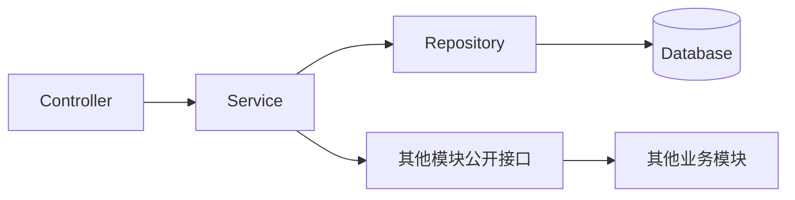

# NestJS 项目结构与模块划分指南

> [!abstract] 文档定位
> 本文基于 NestJS 官方的 Feature Module 思路，给出一套适用于普通企业级 Node.js 后端服务的项目结构。它可以作为新项目脚手架设计、代码评审和团队目录规范的基础。

相关基础概念参见 [[NestJS框架介绍]]。
项目配置文件的组织、加载、校验和部署规范参见 [[NestJS YAML配置管理指南]]。

## 1. 核心结论

NestJS 官方没有规定一套复杂的“企业级目录结构”。官方提供的核心约束是：

1. 按业务功能建立 **Feature Module**。
2. 模块通过 `imports` 声明依赖，通过 `exports` 暴露公共能力。
3. Controller、Service、DTO、Entity 等代码跟随所属业务模块放置。
4. `AppModule` 作为组合根，只负责装配模块，不承载具体业务逻辑。
5. 项目规模扩大后，再逐步引入 Repository、应用层、领域层或 Monorepo，不在项目初期过度设计。

> [!tip] 推荐原则
> 优先按 `users`、`orders`、`vehicles` 等业务能力划分目录，不要在项目顶层建立全局的 `controllers/`、`services/`、`repositories/`，否则同一业务的代码会散落在不同目录中。

## 2. 官方 Starter 的初始结构

NestJS 官方 [`typescript-starter`](https://github.com/nestjs/typescript-starter) 是最小可运行示例：

```text
src/
├── app.controller.spec.ts
├── app.controller.ts
├── app.module.ts
├── app.service.ts
└── main.ts

test/
├── app.e2e-spec.ts
└── jest-e2e.json
```

| 文件 | 职责 |
|---|---|
| `main.ts` | 应用启动入口，创建和配置 Nest Application |
| `app.module.ts` | 根模块，装配业务模块和基础设施模块 |
| `app.controller.ts` | Hello World 示例接口，正式项目可删除 |
| `app.service.ts` | Hello World 示例服务，正式项目可删除 |
| `*.spec.ts` | 单元测试 |
| `test/` | E2E 测试及其配置 |

该仓库用于展示如何启动 NestJS，不应直接视为完整的生产项目结构。

## 3. 推荐的标准项目结构

适用于单个 API 服务、中小型业务系统和模块化单体：

```text
src/
├── main.ts
├── app.module.ts
│
├── config/
│   ├── config.yaml
│   ├── configuration.ts
│   ├── config.types.ts
│   └── config.validation.ts
│
├── common/
│   ├── constants/
│   ├── decorators/
│   ├── exceptions/
│   ├── filters/
│   ├── guards/
│   ├── interceptors/
│   ├── pipes/
│   └── types/
│
├── infrastructure/
│   ├── database/
│   │   ├── database.module.ts
│   │   └── migrations/
│   ├── redis/
│   ├── logging/
│   └── messaging/
│
└── modules/
    ├── auth/
    │   ├── dto/
    │   ├── guards/
    │   ├── strategies/
    │   ├── auth.controller.ts
    │   ├── auth.service.ts
    │   └── auth.module.ts
    │
    ├── users/
    │   ├── dto/
    │   │   ├── create-user.dto.ts
    │   │   ├── update-user.dto.ts
    │   │   └── user-response.dto.ts
    │   ├── entities/
    │   │   └── user.entity.ts
    │   ├── repositories/
    │   │   └── user.repository.ts
    │   ├── users.controller.ts
    │   ├── users.service.ts
    │   ├── users.module.ts
    │   └── users.service.spec.ts
    │
    ├── orders/
    └── notifications/
```

### 3.1 顶层目录职责

| 目录或文件 | 职责 | 不应包含 |
|---|---|---|
| `main.ts` | 启动应用，注册全局 Pipe、Filter、Interceptor、Swagger 和关闭钩子 | 业务逻辑、数据库查询 |
| `app.module.ts` | 导入配置、基础设施和业务模块 | Controller 业务实现、复杂初始化逻辑 |
| `config/` | YAML 配置、类型定义、加载器和启动时校验 | 业务规则 |
| `common/` | 无明确业务归属、可跨模块复用的基础代码 | 只被一个业务模块使用的工具类 |
| `infrastructure/` | 数据库、Redis、日志、消息队列等技术能力 | 用户、订单等具体业务逻辑 |
| `modules/` | 按业务能力组织的 Feature Module | 与业务无关的全局框架配置 |

> [!warning] 避免 Common 目录失控
> 如果一个 Guard、异常类或工具只被 `users` 模块使用，应放在 `modules/users/` 内部。只有真正跨业务复用且语义稳定的代码才能进入 `common/`。

## 4. 单个业务模块结构

普通 CRUD 模块建议从简单结构开始：

```text
modules/users/
├── dto/                    # 接口输入、输出结构及校验规则
├── entities/               # ORM 实体或业务实体
├── repositories/           # 数据访问逻辑
├── exceptions/             # 用户领域特有异常，可选
├── users.controller.ts     # HTTP 接口适配
├── users.service.ts        # 业务用例和规则编排
├── users.module.ts         # 模块依赖装配和公共接口
└── users.service.spec.ts   # 模块单元测试
```

### 4.1 模块内部职责

| 组件 | 负责 | 不负责 |
|---|---|---|
| Controller | 路由、参数接收、DTO 校验、状态码、Swagger、权限声明 | 数据库查询、复杂业务判断 |
| Service | 业务规则、业务流程编排、事务边界 | 直接处理 HTTP Request/Response |
| Repository | 查询和持久化数据、封装 ORM 细节 | HTTP 响应、跨业务流程编排 |
| DTO | 定义接口输入输出和校验规则 | 数据库持久化行为、复杂业务逻辑 |
| Entity | 表达持久化模型或领域状态 | 接口参数接收 |
| Module | 注册 Controller 和 Provider，声明模块依赖及公开能力 | 执行业务流程 |

### 4.2 模块定义示例

```typescript
@Module({
  imports: [DatabaseModule],
  controllers: [UsersController],
  providers: [UsersService, UserRepository],
  exports: [UsersService],
})
export class UsersModule {}
```

该定义表达了四类边界：

- `imports`：当前模块依赖哪些外部模块。
- `controllers`：当前模块提供哪些传输入口。
- `providers`：当前模块内部拥有哪些实现。
- `exports`：其他模块被允许使用哪些能力。

Repository、ORM Entity 和内部辅助服务原则上不对外导出。其他模块应通过 `UsersService` 或专门定义的查询接口访问用户能力。

## 5. Controller、Service 和 Repository 边界

### 5.1 Controller

```typescript
@Controller('users')
export class UsersController {
  constructor(private readonly usersService: UsersService) {}

  @Post()
  create(@Body() dto: CreateUserDto) {
    return this.usersService.create(dto);
  }
}
```

Controller 保持轻量，只完成协议层适配。不要在 Controller 中直接使用 ORM Client 或 Repository。

### 5.2 Service

```typescript
@Injectable()
export class UsersService {
  constructor(private readonly userRepository: UserRepository) {}

  async create(dto: CreateUserDto) {
    const exists = await this.userRepository.existsByUsername(dto.username);

    if (exists) {
      throw new UserAlreadyExistsException(dto.username);
    }

    return this.userRepository.create(dto);
  }
}
```

Service 表达业务用例和业务规则。一个 Service 过大时，应优先按用例拆分，而不是继续堆积方法。

### 5.3 Repository

Repository 用于隔离 Prisma、TypeORM、MikroORM 等持久化实现，使上层业务代码不需要了解具体查询语法。

简单项目可以直接在 Service 中注入 ORM Service；出现以下情况后，再引入 Repository：

- 查询逻辑复杂或在多个用例间复用。
- 需要统一数据访问约束。
- 需要在测试中替换持久化实现。
- 业务层不应直接依赖具体 ORM。

## 6. 模块依赖规则

建议在团队内明确以下规则：

1. 模块之间必须通过 Nest Module 的 `imports` 和 `exports` 建立依赖。
2. 禁止跨模块深层导入内部文件，例如：

   ```typescript
   // 禁止
   import { UserRepository } from '../users/repositories/user.repository';
   ```

3. 其他模块只能依赖目标模块公开的 Service、Token 或 Facade。
4. 禁止循环依赖；出现 `forwardRef()` 时，应先检查职责划分是否合理。
5. 禁止将所有模块声明为 `@Global()`；全局模块只用于少量稳定的基础设施能力。
6. 数据表应有明确的业务模块所有权，不允许其他模块任意操作其 Repository。
7. 跨模块写操作优先通过公开用例或领域事件完成。



## 7. AppModule 和 main.ts 的职责

### 7.1 AppModule

`AppModule` 是应用的组合根，只装配模块：

```typescript
import { Module } from '@nestjs/common';
import { ConfigModule } from '@nestjs/config';
import configuration from './config/configuration';

@Module({
  imports: [
    ConfigModule.forRoot({
      isGlobal: true,
      ignoreEnvFile: true,
      skipProcessEnv: true,
      load: [configuration],
    }),
    DatabaseModule,
    LoggingModule,
    AuthModule,
    UsersModule,
    OrdersModule,
  ],
})
export class AppModule {}
```

YAML 的完整定义、编译复制和启动校验方案参见 [[NestJS YAML配置管理指南]]。

### 7.2 main.ts

`main.ts` 负责应用级启动配置：

```typescript
import { ValidationPipe } from '@nestjs/common';
import { ConfigService } from '@nestjs/config';
import { NestFactory } from '@nestjs/core';
import { AppModule } from './app.module';
import type { AppConfig } from './config/config.types';

async function bootstrap() {
  const app = await NestFactory.create(AppModule);
  const configService = app.get(ConfigService<AppConfig, true>);

  app.setGlobalPrefix(
    configService.get('app.globalPrefix', { infer: true }),
  );
  app.enableShutdownHooks();
  app.useGlobalPipes(
    new ValidationPipe({
      whitelist: true,
      forbidNonWhitelisted: true,
      transform: true,
    }),
  );

  await app.listen(
    configService.get('app.port', { infer: true }),
    configService.get('app.host', { infer: true }),
  );
}

void bootstrap();
```

建议在这里统一配置：

- API 全局前缀和版本策略。
- 参数校验和类型转换。
- Swagger/OpenAPI。
- CORS 和安全响应头。
- 全局异常处理和请求日志。
- 优雅停机。

## 8. 项目结构的渐进式演进

### 8.1 第一阶段：简单模块

适用于原型、小型服务和普通 CRUD：

```text
users/
├── dto/
├── users.controller.ts
├── users.service.ts
└── users.module.ts
```

### 8.2 第二阶段：标准分层

适用于中型业务系统：

```text
users/
├── dto/
├── entities/
├── repositories/
├── exceptions/
├── users.controller.ts
├── users.service.ts
└── users.module.ts
```

### 8.3 第三阶段：复杂领域模块

当模块包含复杂状态流转、跨实体规则或大量业务用例时，可升级为：

```text
modules/orders/
├── api/
│   ├── controllers/
│   └── dto/
├── application/
│   ├── commands/
│   ├── queries/
│   └── services/
├── domain/
│   ├── entities/
│   ├── events/
│   ├── value-objects/
│   └── repositories/
├── infrastructure/
│   ├── persistence/
│   └── clients/
└── orders.module.ts
```

各层职责：

| 分层 | 职责 |
|---|---|
| `api` | HTTP、RPC、消息消费等传输入口 |
| `application` | 用例编排、事务控制、命令和查询 |
| `domain` | 实体、值对象、领域服务、领域事件和端口定义 |
| `infrastructure` | 数据库、缓存、消息队列和第三方系统实现 |

相关领域设计方法可参考 [[微服务/DDD 中的实体与值对象]] 和 [[微服务/领域分析（战略 DDD）实践指南]]。

> [!warning] 不要过早引入复杂分层
> 简单 CRUD 不需要为每个操作创建 Command、Handler、Port 和 Mapper。只有业务复杂度已经出现时，复杂架构才有收益。

## 9. 模块说明文档模板

核心业务模块可增加 `README.md`，明确模块职责和边界：

```markdown
# Orders Module

## 职责

- 创建、取消和查询订单。
- 管理订单状态流转。

## 不负责

- 不执行真实支付扣款，支付由 Payment Module 负责。
- 不直接修改库存，库存由 Inventory Module 负责。

## 对外提供

- `OrdersService`
- `OrderQueryService`

## 依赖

- `UsersModule`
- `InventoryModule`
- `PaymentModule`

## 数据所有权

- `orders`
- `order_items`

## 发布事件

- `order.created`
- `order.cancelled`

## 消费事件

- `payment.succeeded`
- `payment.failed`
```

建议至少为复杂模块记录：

- 负责什么。
- 明确不负责什么。
- 对外公开哪些能力。
- 依赖哪些模块或外部系统。
- 拥有哪些数据表。
- 发布和消费哪些事件。

## 10. CLI 生成命令

创建普通模块和组件：

```bash
nest g module modules/users
nest g controller modules/users
nest g service modules/users
```

创建完整 CRUD Resource：

```bash
nest g resource modules/users
```

`nest g resource` 可生成 Module、Controller、Service、DTO、Entity 和测试文件，并支持 REST、GraphQL、Microservice 和 WebSocket 类型。

生成后仍需要根据本规范调整职责和依赖，不能将生成代码直接等同于最终设计。

## 11. Monorepo 结构

只有在存在多个可独立运行的应用时，才建议采用 Monorepo，例如 API、定时任务、消息消费者和后台服务：

```text
apps/
├── api/
│   └── src/
├── consumer/
│   └── src/
└── scheduler/
    └── src/

libs/
├── users/
├── orders/
├── database/
└── logging/
```

| 目录 | 定位 |
|---|---|
| `apps/` | 可独立启动和部署的应用，拥有自己的 `main.ts` |
| `libs/` | 不可独立运行、供应用复用的模块或基础能力 |

单个后端服务不需要为了“看起来工程化”而过早引入 Monorepo。NestJS 标准模式可以在后续通过 CLI 转换为 Monorepo 模式。

## 12. 工程化配套建议

项目结构之外，生产项目还应具备以下能力：

- [ ] TypeScript 开启严格类型检查。
- [ ] YAML 配置有启动时校验，缺少关键配置时拒绝启动。
- [ ] 密钥和密码统一存放于受控 YAML，并在日志和诊断接口中脱敏。
- [ ] 全局启用请求参数白名单和类型转换。
- [ ] 统一错误码、异常响应格式和异常日志。
- [ ] 使用结构化日志并记录 Trace ID 或 Request ID。
- [ ] 提供 Swagger/OpenAPI 文档。
- [ ] 提供健康检查和优雅停机。
- [ ] 数据库变更通过 Migration 管理。
- [ ] 核心业务包含单元测试和接口级 E2E 测试。
- [ ] 使用 ESLint、Prettier 和提交前检查。
- [ ] CI 中执行类型检查、Lint、测试和构建。
- [ ] Docker 镜像使用非 root 用户运行，并区分构建与运行阶段。
- [ ] 对跨模块深层导入和循环依赖进行自动检查。

## 13. 推荐落地方案

对于新建的普通企业级 NestJS 服务，建议采用以下基线：

```text
NestJS
├── Fastify Adapter 或默认 Express
├── PostgreSQL / MySQL
├── Prisma、TypeORM 或 MikroORM
├── Redis
├── Swagger / OpenAPI
├── Pino 结构化日志
├── Jest + Supertest
├── Docker
└── GitHub Actions / GitLab CI
```

最终推荐目录为：

```text
src/
├── main.ts
├── app.module.ts
├── config/
├── common/
├── infrastructure/
└── modules/
    ├── auth/
    ├── users/
    ├── orders/
    └── notifications/
```

在此基础上坚持三个原则：

1. **按业务模块组织代码。**
2. **通过模块公开接口建立依赖。**
3. **根据真实复杂度渐进式增加分层。**

## 14. 参考资料

- [NestJS TypeScript Starter](https://github.com/nestjs/typescript-starter)
- [NestJS Modules](https://docs.nestjs.com/modules)
- [NestJS CLI Overview](https://docs.nestjs.com/cli/overview)
- [NestJS CRUD Generator](https://docs.nestjs.com/recipes/crud-generator)
- [NestJS Workspaces](https://docs.nestjs.com/cli/monorepo)
- [[NestJS YAML配置管理指南]]
