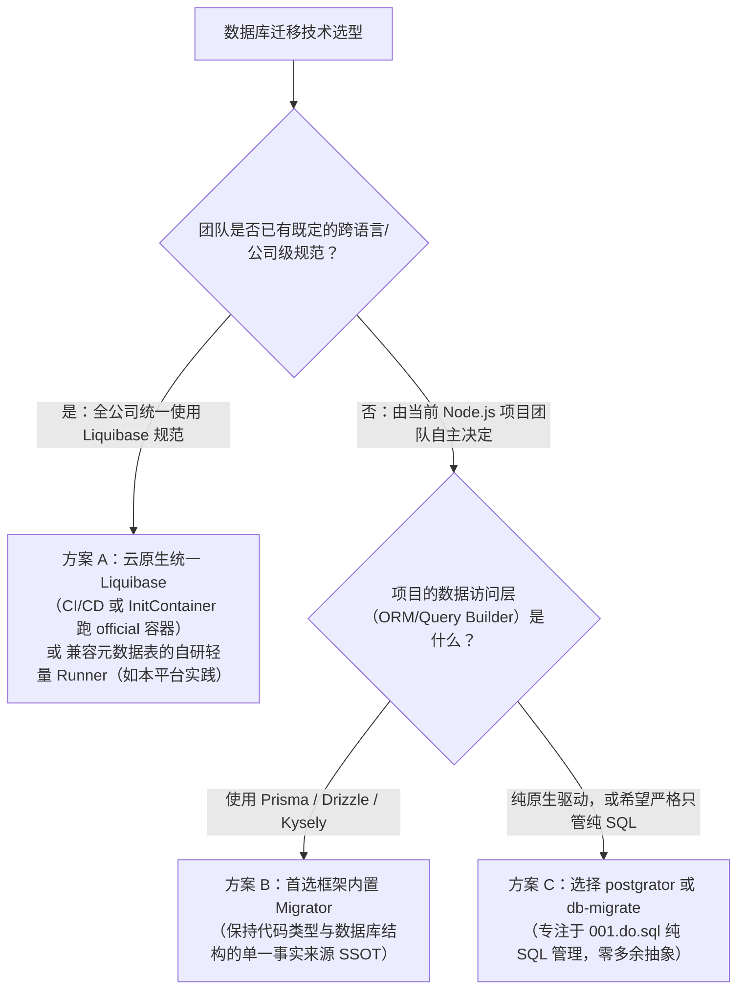

# Node.js 数据库迁移工具选型与 Liquibase 对比

## 1. 概述

数据库版本迁移（Database Schema Migration）是现代软件工程中保证数据库结构与应用程序代码协同演进、支持可重复部署与回滚的关键手段。

在 Java 生态中，**Liquibase** 与 **Flyway** 是几乎垄断行业标准的工具，其核心特性包括：
* 基于版本日志（Changelog）与变更集（Changeset）的原子管理；
* 专用的数据库元数据追踪表（如 `DATABASECHANGELOG`）；
* 强校验防篡改（MD5 校验和校验）；
* 分布式锁机制（防止多实例并发迁移冲突）；
* 前置条件（PreConditions）与幂等回滚能力。

在 Node.js / TypeScript 生态中，开发者面临多样化的技术栈选择。目前社区中的迁移方案主要分为两大阵营：**独立纯迁移工具** 与 **现代 ORM / Query Builder 内置迁移体系**。

---

## 2. 独立专用迁移工具（无 ORM 绑定）

这类工具专注于“执行变更脚本并记录版本元数据”，与应用程序的业务查询层解耦，最接近 Liquibase / Flyway 的纯粹工具理念。

### 2.1 `db-migrate`（成熟老牌、功能全面的独立 CLI）

* **定位**：Node.js 生态中最资深的独立迁移框架，定位类似 Node 版本的 Flyway。
* **特性**：
  * 支持纯 SQL 迁移，也支持使用 JS/TS API 声明式修改表结构；
  * 提供完善的 CLI 命令：`db-migrate up`、`db-migrate down`、`db-migrate reset` 等；
  * 丰富的驱动生态：MySQL、PostgreSQL、SQLite、MongoDB 等插件化适配。
* **适用场景**：大型老旧项目、多数据库方言支持、无需 ORM 绑定的传统服务。

### 2.2 `postgrator`（轻量、专为纯 SQL 驱动设计）

* **定位**：专为崇尚“手写高质量 SQL 脚本”团队设计的轻量迁移器（支持 MySQL、PostgreSQL、SQL Server）。
* **规范命名机制**：
  * 采用直观的文件命名约定：
    * `001.do.sql`（升级执行脚本）
    * `001.undo.sql`（回滚执行脚本）
* **优势**：
  * **零抽象泄露**：不引入专有 DSL 或标签，直接编写原生 SQL；
  * **嵌入简单**：既提供 CLI，也可作为 Node.js 库直接在服务启动或脚本中以几十行代码唤起；
  * 自动在数据库维护 schema 版本记录表。
* **适用场景**：SQL 功底扎实、拒绝 ORM 抽象层黑盒、喜欢直观维护 `.sql` 文件的团队。

### 2.3 `marv`（极简嵌入式执行器）

* **定位**：极度轻量的 SQL 迁移运行器。
* **特性**：专注于扫描特定目录的 SQL 文件、比对版本表并按序执行，易于编写自定义的连接插件与运行钩子。

---

## 3. 现代 ORM / Query Builder 内置迁移系统

随着 TypeScript 成为 Node.js 后端开发的主流，现代数据访问层框架普遍内置了强类型的迁移系统，将 Schema 变更与代码类型定义打通。

### 3.1 `Kysely Migrator`（示例项目 底层技术栈）

* **定位**：纯 TypeScript、类型安全、零代码生成的现代 SQL Query Builder。
* **迁移机制**：
  * 内置 `Migrator` 类与 `FileMigrationProvider`；
  * 使用 TypeScript 文件定义迁移逻辑，提供强类型上下文：
    ```typescript
    import { Kysely } from 'kysely';

    export async function up(db: Kysely<any>): Promise<void> {
      await db.schema
        .createTable('t_user')
        .addColumn('id', 'varchar(64)', (col) => col.primaryKey())
        .addColumn('name', 'varchar(128)', (col) => col.notNull())
        .execute();
    }

    export async function down(db: Kysely<any>): Promise<void> {
      await db.schema.dropTable('t_user').execute();
    }
    ```
  * 自动维护 `kysely_migration` 记录表与 `kysely_migration_lock` 分布式锁表。
* **优势**：与业务代码的类型系统天然统一，支持在迁移脚本中安全调用复杂逻辑。

### 3.2 `Prisma Migrate`（声明式模型对比与变更驱动）

* **定位**：当前 Node.js 生态中最流行、开发者体验（DX）最出色的声明式迁移体系。
* **工作机制**：
  1. 开发者直接修改声明式的 `schema.prisma` 模型文件；
  2. 运行 `prisma migrate dev`：Prisma 自动计算当前 schema 与数据库现状的差异（Diff），生成带时间戳的纯 SQL 迁移目录；
  3. 自动检测并提示破坏性变更（Data loss warnings）；
  4. 生产环境运行 `prisma migrate deploy` 执行未应用的 SQL，并在 `_prisma_migrations` 表中做校验和与时间戳登记。
* **优势**：极大减轻人工手写 DDL 的心智负担，同时生成物依然是可审查的纯 SQL。

### 3.3 `Drizzle Kit`（极致轻量、现代高性能的代表）

* **定位**：近两年在 TypeScript 社区迅速崛起的 SQL-like ORM。
* **工作机制**：
  * `drizzle-kit generate`：根据 TS 代码中的表结构定义（TypeScript Schema）生成迁移 SQL 与快照 JSON；
  * `drizzle-kit migrate`：将变更应用到数据库。
* **优势**：体积小、启动快、生成的 SQL 极其直观，没有复杂黑盒运行时。

### 3.4 `Knex.js Migrations`（经典成熟的行业基石）

* **定位**：Node.js 社区使用历史最悠久、最稳定的 SQL Query Builder。
* **机制**：提供 `knex migrate:latest`、`knex migrate:rollback` 等经典 CLI，在各大企业系统中应用广泛。

---

## 4. Node.js 迁移工具 vs Java Liquibase 全景对比

| 核心维度 | Java Liquibase | Node.js 独立迁移工具<br>(如 postgrator / db-migrate) | 现代 TS 迁移方案<br>(如 Kysely / Drizzle / Prisma) |
| :--- | :--- | :--- | :--- |
| **运行时依赖** | 强依赖 JRE (Java 虚拟机) | 纯 Node.js / V8 引擎 | 纯 Node.js / TypeScript |
| **变更定义载体** | XML、YAML、JSON、Formatted SQL、Groovy | 纯 SQL 文件或 JavaScript 脚本 | TypeScript 代码或模型文件自动推导的 SQL |
| **跨数据库方言抽象**| 极强（一份 XML/YAML 可适配 MySQL/Oracle/PG 等数十种数据库） | 较弱（通常直接编写特定方言的 SQL） | 强（通过 TS Schema Builder 抽象屏蔽方言差异） |
| **细粒度控制 (Changeset)**| 单文件可包含多个 Changeset，含作者、ID、执行上下文、哈希防篡改 | 通常以单个文件为一个版本单位 | 通常以单个文件或单个时间戳为一个版本单位 |
| **分布式锁** | 内置 `DATABASECHANGELOGLOCK` | 部分支持或依赖外部锁 | 通常内置（如 `kysely_migration_lock`） |
| **高级企业特性** | 标记打点 (Tag)、复杂条件校验 (PreConditions)、审计哈希检测 | 偏精简，仅保证基础版本线向前推进 | 注重与代码类型系统联动、模式漂移检测（Schema Drift） |

---

## 5. 企业级场景选型建议



### 5.1 场景一：混合多语言微服务架构（既有 Java 也有 Node.js）
* **推荐实践**：
  * **生产流水线**：不要在 Node 容器里装 Java。在 CI/CD 流水线中，或者 Kubernetes 部署时使用官方 `liquibase/liquibase` Docker 镜像以 InitContainer 方式统一执行迁移。
  * **轻量本地兼容（示例项目模式）**：沿用 Liquibase 标准的 `DATABASECHANGELOG` 元数据表，本地使用轻量 TypeScript 脚本进行有序 SQL 执行（`npm run migrate`）和启动强校验，保证不同语言微服务对数据库变更的认知一致。

### 5.2 场景二：全新现代 TypeScript 全栈服务
* **推荐实践**：
  * 优先使用 **Prisma Migrate** 或 **Drizzle Kit**。
  * 这类工具能将类型推导、代码自动补全、模式漂移检测和变更生成无缝串联，大幅提升开发效率与团队交付体验。

### 5.3 场景三：以 DBA / 纯 SQL 规范为主导的团队
* **推荐实践**：
  * 选用 **`postgrator`**。
  * 严格按照 `xxx.do.sql` 和 `xxx.undo.sql` 组织代码，开发与 DBA 均可直接审查 SQL，完全规避 ORM 生成低效 SQL 的风险。
