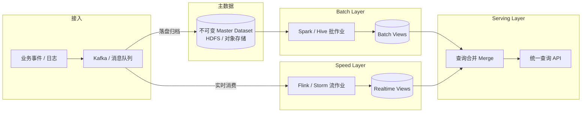
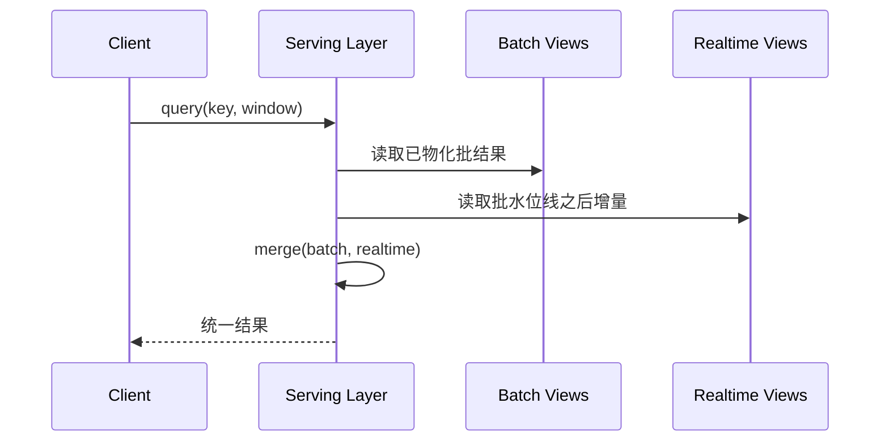

# 大数据 Lambda 架构

> [!abstract] 一句话定义
> **Lambda Architecture**（Nathan Marz 提出）是一套面向海量数据的架构模式：用 **不可变主数据（master dataset）+ 批量全量重算** 保证准确性，用 **实时流处理** 弥补批处理延迟，再在查询层把两者结果合并，从而同时追求「最终准确」与「低延迟可见」。

---

## 1. 业务场景与设计动机

### 1.1 典型痛点

在广告计费、风控画像、IoT 轨迹统计、日志指标等场景里，业务往往同时提出两句互相拉扯的话：

| 诉求 | 含义 |
| --- | --- |
| **准确全量** | 历史数据可重算、可纠错，结果可审计，不因一次脏数据永久偏掉 |
| **低延迟增量** | 几秒到分钟级就能看到「刚发生的事」，不能等第二天批跑完 |

单独用批处理：准，但慢。  
单独用流处理：快，但一旦逻辑写错、时钟乱序、状态丢失，纠错成本高，且很难「从头再算一遍世界」。

### 1.2 设计动机（Why Lambda）

Lambda 的核心假设是：

1. **原始数据尽量 append-only、不可变** —— 错误通过重算修正，而不是原地改历史。
2. **批处理是真相来源（source of truth 的计算侧）** —— 用全量数据定期产出权威视图。
3. **流处理是「窗口期补丁」** —— 覆盖「上一批结束 → 当前」之间的新鲜数据。
4. **查询时合并（merge）** —— 对外仍像一个统一查询面。

> 动机一句话：**用冗余计算换取「可纠错的准确性」和「可接受的新鲜度」。**

---

## 2. 三层架构详解

```text
                    ┌─────────────────────────────┐
  新事件 ──────────►│        不可变主数据           │
                    │   (HDFS / S3 / 对象存储等)   │
                    └────────────┬────────────────┘
                                 │
              ┌──────────────────┼──────────────────┐
              ▼                  │                  ▼
      ┌───────────────┐          │          ┌───────────────┐
      │  Batch Layer  │          │          │  Speed Layer  │
      │  全量批处理    │          │          │  实时增量      │
      └───────┬───────┘          │          └───────┬───────┘
              │ batch views      │          realtime views
              ▼                  │                  ▼
                    ┌────────────┴────────────┐
                    │     Serving Layer       │
                    │  合并查询 / 对外服务      │
                    └─────────────────────────┘
```

### 2.1 Batch Layer（批处理层）

| 维度 | 说明 |
| --- | --- |
| **职责** | 持久化全部原始数据；周期性对主数据做全量（或大范围增量）计算，产出 **batch views** |
| **强调** | 正确性、可重放、可审计；延迟可到小时～天级 |
| **输入** | 不可变主数据集（append-only 事件流落盘） |
| **输出** | 预计算好的批量视图（如按用户聚合的指标表、倒排索引、OLAP 分区表） |
| **典型技术栈** | 存储：HDFS / S3 / OSS；计算：MapReduce、Spark、Hive、Flink Batch；编排：Airflow / DolphinScheduler |

要点：

- 批层假设「可以再算一遍」——逻辑变更、Bug 修复后，对主数据 **recompute**。
- 视图通常按分区（天/小时）物化，便于 Serving 层高效读取。

### 2.2 Speed Layer（加速 / 实时层）

| 维度 | 说明 |
| --- | --- |
| **职责** | 仅处理「批层尚未覆盖」的近期数据，产出 **realtime views**，填补新鲜度缺口 |
| **强调** | 低延迟；可牺牲部分完备性（最终会被批层纠正） |
| **输入** | 与主数据同源的实时流（Kafka / Pulsar 等） |
| **输出** | 近实时增量视图（常驻内存或短时持久化 KV / 时序库） |
| **典型技术栈** | Kafka + Storm / Flink / Spark Streaming；状态：RocksDB、Redis；视图：Cassandra、HBase、Redis、ClickHouse 近实时表 |

要点：

- Speed Layer 的结果是 **临时的**：某一时间点的批作业追上后，对应实时视图可丢弃或滚动清理。
- 实现上常与批层共享「同一套业务语义」，但代码路径往往是两套（这是代价来源，见第 4 节）。

### 2.3 Serving Layer（服务层）

| 维度 | 说明 |
| --- | --- |
| **职责** | 索引/存储 batch views 与 realtime views，对外提供低延迟查询，并在查询时 **合并** 两边结果 |
| **强调** | 读性能、合并语义清晰、对上层屏蔽双视图细节 |
| **输入** | Batch views + Realtime views |
| **输出** | 统一查询 API / SQL 视图 / 报表服务 |
| **典型技术栈** | 批视图：ElephantDB、Druid、ClickHouse、Doris、Hive + 加速引擎；实时视图：Cassandra、HBase、Redis；查询：自研 Merge API、Presto/Trino、应用层合并 |

合并语义常见模式：

- **覆盖（override）**：同一 key 以批视图为准，实时视图只补「批未覆盖」的时间窗。
- **相加（additive）**：计数类指标 `batch_count + realtime_count`（需严格定义时间边界，避免双计）。
- **最新优先**：带版本号 / 事件时间，取较新者。

> ⚠️ 合并规则必须和业务指标类型绑定；「随便相加」在去重 UV、max、distinct 等指标上会错。

---

## 3. 数据流与查询合并（Mermaid）



**查询时序（简化）**：

1. 客户端查「用户 U 在窗口 W 的指标」。
2. Serving 读 batch view 中「已完成批窗口」的部分。
3. 再读 realtime view 中「批作业水位线之后」的增量。
4. 按指标类型做 merge，返回统一结果。
5. 下一批跑完并发布新 batch view 后，抬高水位线，清理过期 realtime 数据。



---

## 4. 优点与代价

### 4.1 优点

| 优点 | 说明 |
| --- | --- |
| **准确性可恢复** | 主数据不可变 + 批全量重算，逻辑 Bug 可修复后重放 |
| **新鲜度可接受** | Speed Layer 补齐批延迟窗口 |
| **容错友好** | 批层天然可重试；实时层挂了最多「短时间变旧」，批追上后仍可对齐 |
| **关注点分离** | 「权威计算」与「低延迟补丁」职责清晰 |

### 4.2 代价

| 代价 | 说明 |
| --- | --- |
| **双写 / 双实现逻辑** | 同一业务指标往往要在批代码与流代码各写一遍，语义漂移风险高 |
| **运维复杂度** | 两套作业、两套视图、水位线、清理策略、回填流程都要管 |
| **一致性语义难** | 「最终一致」到「查询瞬间读到什么」需要明确 SLA；跨层合并易双计或漏计 |
| **存储与计算冗余** | 主数据 + 批视图 + 实时视图，成本明显高于单路径架构 |
| **上线节奏慢** | 改一个指标可能要同步改批、流、合并规则与回归用例 |

> ⚠️ 「双写」在此多指 **同一套业务逻辑在批/流两条计算路径上的重复实现**，不一定是向两个库各写一份原始事件；原始事件通常仍是单通道接入后再 fan-out。

---

## 5. 与 Kappa 架构对比，以及流批一体演进

### 5.1 对比表

| 维度 | Lambda | Kappa |
| --- | --- | --- |
| 提出语境 | Nathan Marz；批 + 流双路径 | Jay Kreps；尽量只用流系统 |
| 主计算路径 | Batch + Speed | 以流处理为主（可重放） |
| 真相来源 | 不可变主数据 + 批重算 | 日志（如 Kafka）可重放 + 流作业再处理 |
| 代码路径 | 常双实现 | 理想情况单套流逻辑 |
| 延迟 | 批慢 + 流快，查询合并 | 取决于流作业与状态 |
| 纠错方式 | 改批逻辑后全量/大范围重算 | 从日志偏移重放、重建状态与视图 |
| 运维 | 两套系统更重 | 系统更少，但对流引擎与重放能力要求高 |
| 典型痛点 | 逻辑双维护、合并复杂 | 超大历史重放成本、复杂批语义用流表达别扭 |

### 5.2 流批一体的演进

行业演进大致是：

1. **Lambda 时代**：批（MR/Hive）与流（Storm）技术栈分裂，只能双路径。
2. **Kappa 思路**：强化「日志 + 可重放流」，减少双代码。
3. **流批一体引擎**：Flink / Spark 等用同一套 API 与语义覆盖批与流（bounded / unbounded），配合统一数仓表格式（Iceberg / Hudi / Paimon）与仓内实时（Doris / ClickHouse）。
4. **实践现状**：许多团队不再机械落地经典三层，而是：
   - 原始数据仍不可变归档；
   - 用 **一套计算引擎 + 多层表（ODS/DWD/DWS）**；
   - 用 **增量物化 / 近实时数仓** 替代独立 Speed Layer；
   - 保留「可重算」思想，弱化「两套代码」。

> ⚠️ 「流批一体」消除的是 **引擎与 API 分裂**，不自动消除 **指标口径与状态语义** 的复杂度；乱序、Exactly-once、回刷策略仍要设计。

---

## 6. 易混点澄清（各一句）

| 名称 | 澄清 |
| --- | --- |
| **Java `lambda` 表达式** | 语言特性（匿名函数），与大数据 Lambda 架构无关。 |
| **AWS Lambda** | 云厂商的 Serverless 函数计算服务，按事件触发跑短任务；名字碰巧相同，不是 Nathan Marz 的大数据架构模式。 |

---

## 7. 适用与不适用场景

### 7.1 较适用

- 需要 **强可审计 / 可回放纠错**（计费、合规报表、资金类汇总）。
- 批处理窗口不可避免（T+1 对账、全量重塑宽表），但又要 **分钟级看板**。
- 组织已有成熟离线数仓，只需加一层实时补丁，且能接受双路径成本。
- 指标以 **可加总、可窗口切割** 的为主，合并规则好定义。

### 7.2 不太适用 / 需谨慎

- 团队规模小、指标变更极频繁 —— 双实现会拖垮迭代。
- 指标高度依赖复杂去重、图计算、强一致事务语义 —— 合并层极易错。
- 已具备成熟流批一体 + 湖仓表格式，且重放链路顺畅 —— 经典 Lambda 可能过度设计。
- 数据量其实不大、单库/单仓 OLAP 已能同时满足延迟与准确 —— 不必上三层。

---

## 8. 小结

- Lambda 架构用 **Batch（准）+ Speed（快）+ Serving（合）** 同时回应全量准确与低延迟。
- 它的力量来自 **不可变主数据与可重算**；它的账单是 **双路径逻辑、运维与一致性设计**。
- 对照 Kappa 与流批一体：思想遗产（可重放、可纠错、统一查询体验）仍在，落地形态已更多走向 **单引擎 + 湖仓 + 近实时数仓**。
- 选型时先写清：指标合并语义、水位线、回刷谁说了算；再决定要不要经典三层。

---

## 9. 自测题（附简要参考答案）

**Q1.** Lambda 架构里，为什么强调原始主数据尽量不可变？Speed Layer 挂了会不会永久丢「真相」？

> **参考答案：** 不可变 + append-only 使任意时刻都能基于完整历史重算 batch views，从而修复逻辑错误。Speed Layer 通常只提供批水位线之后的临时视图；主数据若已落盘，实时层故障最多导致短暂不新鲜，批作业追上后仍可恢复权威结果。⚠️ 若接入阶段就丢事件且未入主数据，则批也救不回。

**Q2.** 查询合并时，对「UV（去重用户数）」直接做 `batch_uv + realtime_uv` 可能有什么问题？更好的方向是什么？

> **参考答案：** 同一用户可能同时出现在批窗口与实时窗口，直接相加会 **双计**。更好的方向包括：按事件时间严格切分互斥窗口、在合并层做跨层去重（成本高）、或改用 HyperLogLog 等可合并结构并明确误差与边界。⚠️ 具体算法选型依赖精度 SLA。

**Q3.** 若团队已用 Flink + Iceberg/Paimon 做流批一体，是否还「必须」上经典 Lambda 三层？判断标准是什么？

> **参考答案：** 不必须。若单套作业能重放、能产出权威表，且近实时查询已由仓内引擎满足，可用 Kappa/流批一体弱化双代码。仍考虑 Lambda 式拆分的信号包括：监管要求「离线全量重算」与「在线链路」物理隔离、现有离线资产极重且短期无法统一、或实时与批的 SLA/团队边界必须分开。判断标准看 **口径一致性成本 vs 双路径运维成本**。

---

## 参考与延伸

- Nathan Marz, *Big Data*（Lambda Architecture 原始论述）
- Jay Kreps, *Questioning the Lambda Architecture*（Kappa 思路）
- 本库相关笔记：[[数仓分层架构]] · [[Spark 学习指南（大数据工程-实战架构方向）]]（同目录）

