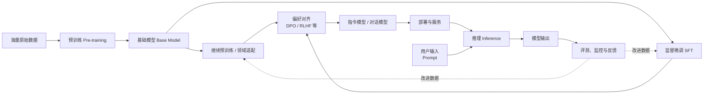

# 大模型中的训练、预训练、后训练与推理

## 一句话先串起来

可以把一个大模型理解成一个“先学习语言和世界规律，再学习如何完成任务，最后在用户面前实际答题”的系统：

> **预训练**让模型获得通用能力；**后训练**让模型更会听指令、更符合人的偏好；**推理**是模型部署后根据输入生成输出的过程；而**训练**是包含预训练、后训练等阶段的总称。



## 1. 什么是“训练”

训练是通过数据和优化算法调整模型参数，使模型的输出越来越符合目标的过程。

大模型内部有大量参数，可以粗略理解为模型从数据中学到的“知识、模式和表达习惯”。训练时通常会经历以下循环：

1. 把文本转换成模型能处理的 Token。
2. 将 Token 输入模型，得到预测结果。
3. 用损失函数比较预测结果和目标答案的差异。
4. 通过反向传播计算参数应如何调整。
5. 使用优化器更新参数，重复很多轮。

训练阶段模型参数会被更新，因此需要大量算力、显存和数据。训练的目标可能是学习通用语言能力，也可能是适应某个领域或某类任务。

## 2. 预训练：先学会“语言和世界的基本规律”

### 2.1 定义

预训练（Pre-training）是大模型训练的基础阶段。模型使用规模很大的通用数据集，学习词语之间的关系、语法、知识关联、代码模式以及不同文本风格。

对大多数现代自回归语言模型来说，最典型的任务是“根据前面的内容预测下一个 Token”。例如：

```text
输入：北京是中国的
目标：首都
```

模型并不是通过逐条背诵问答来学习，而是在大量文本中不断进行预测。随着参数、数据和训练计算量增加，模型可能逐渐形成总结、翻译、代码生成和简单推理等通用能力。

### 2.2 预训练产物：基础模型

预训练完成后得到的通常是基础模型（Base Model）。它擅长续写和理解语言，但不一定擅长直接遵循用户指令。

例如，用户输入“请解释什么是数据库”，基础模型可能把它当成文章开头继续续写，而不是稳定地给出一份结构化解释。基础模型更像是“读过很多书、掌握语言规律的学生”，但还没有专门接受“如何答题”的训练。

### 2.3 继续预训练

继续预训练（Continued Pre-training）是在已有基础模型上，使用某个领域的无标注语料继续进行语言建模训练。

它适合让模型熟悉金融、医疗、法律、企业内部知识或某种编程语言的术语和表达方式。它解决的是“模型对这个领域的语言和知识分布不够熟悉”，不等同于教模型严格按指定格式回答。

## 3. 后训练：把基础模型变成“会完成任务的助手”

后训练（Post-training）是预训练之后的一系列训练阶段的总称。不同机构的具体流程不完全相同，常见组成包括监督微调、偏好对齐、安全训练和能力增强等。

### 3.1 监督微调（SFT）

监督微调（Supervised Fine-Tuning）使用“指令—高质量答案”样本训练模型。例如：

```text
指令：把下面的句子翻译成英文：今天天气很好。
答案：The weather is nice today.
```

SFT 让模型学习：

- 如何识别用户意图；
- 如何按照示例完成任务；
- 如何使用特定格式输出；
- 如何表现得像对话助手、代码助手或领域助手。

SFT 不一定让模型获得全新的知识。更多时候，它是在已有能力上塑造行为方式。数据质量、覆盖范围和答案一致性通常比样本数量更重要。

### 3.2 偏好对齐：学习“哪个答案更好”

同一个问题可能有多个都正确的答案，但它们在准确性、简洁性、安全性和可读性上存在差异。因此，后训练还常用偏好数据让模型学会选择更符合人类偏好的回答。

常见方法包括：

- **RLHF**：人类比较多个答案，训练奖励模型，再通过强化学习优化语言模型。
- **DPO**：直接利用“偏好答案 / 非偏好答案”对优化模型，流程通常比 RLHF 更简单。
- **RLAIF**：使用 AI 产生或辅助产生偏好判断。

这类训练重点不是单纯增加事实知识，而是改善回答风格、指令遵循、拒答边界和整体可靠性。

### 3.3 安全与能力增强

后训练还可能加入安全数据、工具调用数据、长上下文数据、数学与代码数据、多语言数据等，让模型更适合实际产品场景。

因此，“后训练”不是某一个固定算法，而是“预训练之后，为了让模型可用而进行的一组训练工作”。

## 4. 推理：模型上线后如何回答问题

推理（Inference）是使用已经训练完成的模型，根据输入计算输出的过程。

用户发送 Prompt 后，系统大致会经历：

1. 对输入进行分词，转换成 Token。
2. 模型根据上下文计算下一个 Token 的概率。
3. 按照解码策略选择一个 Token。
4. 把新 Token 接回上下文，继续预测下一个 Token。
5. 直到生成结束标记或达到长度上限。

这就是为什么语言模型通常是“一个 Token、一个 Token”地生成答案。

推理阶段通常不会更新模型参数。模型是在“使用已经学会的能力”，而不是重新学习。对话历史、系统提示词、检索到的资料和工具返回值，会作为当前请求的上下文影响输出，但它们通常不会永久写入模型参数。

## 5. 训练和推理的关键区别

| 对比项 | 训练 | 推理 |
| --- | --- | --- |
| 目的 | 改变模型参数、提升或塑造能力 | 使用现有参数生成结果 |
| 是否更新参数 | 是 | 通常否 |
| 输入 | 训练数据、标签或偏好数据 | 用户 Prompt、上下文、工具结果 |
| 资源特点 | 计算量大、周期长、需要反向传播 | 更关注响应延迟、吞吐和单次成本 |
| 结果 | 新的模型检查点或适配器 | 当前请求的文本、结构化数据或动作 |
| 常见问题 | 过拟合、数据污染、训练不稳定 | 幻觉、延迟、上下文过长、输出不稳定 |

一个容易混淆的点是：推理时模型也在进行大量计算，但这些计算不叫“训练”，因为通常没有根据答案误差更新参数。

## 6. 参数、上下文和知识分别在哪里

可以用三个位置区分模型能力来源：

### 6.1 参数：长期能力

预训练和后训练写入模型参数的是相对长期的能力，包括语言规律、部分事实知识、任务模式和回答倾向。修改参数需要训练或微调。

### 6.2 上下文：当前会话能力

用户问题、对话历史、系统指令和临时资料位于上下文中。它们能影响当前回答，但一般不会自动永久改变模型。

### 6.3 外部工具和知识库：运行时补充

搜索、RAG 知识库、数据库和业务 API 可以在推理时提供最新或私有信息。这样做通常不需要重新训练模型，但需要设计检索、权限、引用和错误处理流程。

## 7. 一个完整例子：企业客服大模型如何做出来

以“企业内部客服助手”为例：

1. **预训练**：模型先在海量通用文本上学习语言、常识和基本推理能力。
2. **领域继续预训练**：用企业产品文档、行业术语和历史资料，让模型熟悉业务语言；涉及隐私时需要脱敏和权限控制。
3. **SFT**：准备客服问题、标准答案、流程说明和拒答案例，让模型学会按客服规范回答。
4. **偏好对齐**：让人工或评审模型比较不同答案，偏好准确、简洁、礼貌且不越权的答案。
5. **知识库接入**：在推理时检索最新产品文档和政策，不把所有变更都重新训练进参数。
6. **推理服务**：用户提问后，系统拼装 Prompt 和检索结果，调用模型生成答案。
7. **评测与迭代**：收集错误案例，判断是知识缺失、检索失败、提示词问题还是模型行为问题，再分别改进数据、后训练或推理链路。

这个例子说明：训练负责塑造模型本身，推理负责让模型在具体请求中工作；最新业务事实则往往通过知识库和工具在推理时提供。

## 8. 相关概念的层级关系

```text
大模型生命周期
├── 训练（Training）
│   ├── 预训练（Pre-training）
│   ├── 继续预训练（Continued Pre-training）
│   └── 后训练（Post-training）
│       ├── 监督微调（SFT）
│       ├── 偏好对齐（RLHF / DPO / RLAIF）
│       ├── 安全训练
│       └── 工具调用、代码、长上下文等能力增强
└── 部署与使用
    ├── 推理（Inference）
    ├── RAG / 搜索 / 工具调用
    ├── 评测与监控
    └── 根据反馈重新训练或调整系统
```

## 9. 最容易记住的类比

把模型比作一个学生：

- **预训练**：读大量书，建立语言和知识基础。
- **继续预训练**：集中阅读某个专业领域的教材。
- **SFT**：做老师布置的示范题，学习答题格式和方法。
- **偏好对齐**：老师比较不同答案，告诉他什么样的答案更好、更安全。
- **推理**：毕业后面对具体问题现场作答。
- **RAG / 工具调用**：答题时查阅最新资料或使用计算器、数据库。
- **重新训练**：发现一类问题总答错后，补充材料并重新学习。

## 10. 结论

理解这些概念时，可以只记住三层：

1. **训练是总过程**：通过数据和优化改变模型参数。
2. **预训练与后训练是训练的不同阶段**：预训练建立通用基础，后训练塑造可用行为和偏好。
3. **推理是使用阶段**：模型在不更新参数的情况下，根据当前输入和上下文生成结果。

实际应用中，模型效果通常不是只由模型大小决定，而是由“训练数据 + 后训练质量 + Prompt + 检索与工具 + 推理部署 + 评测迭代”共同决定。
