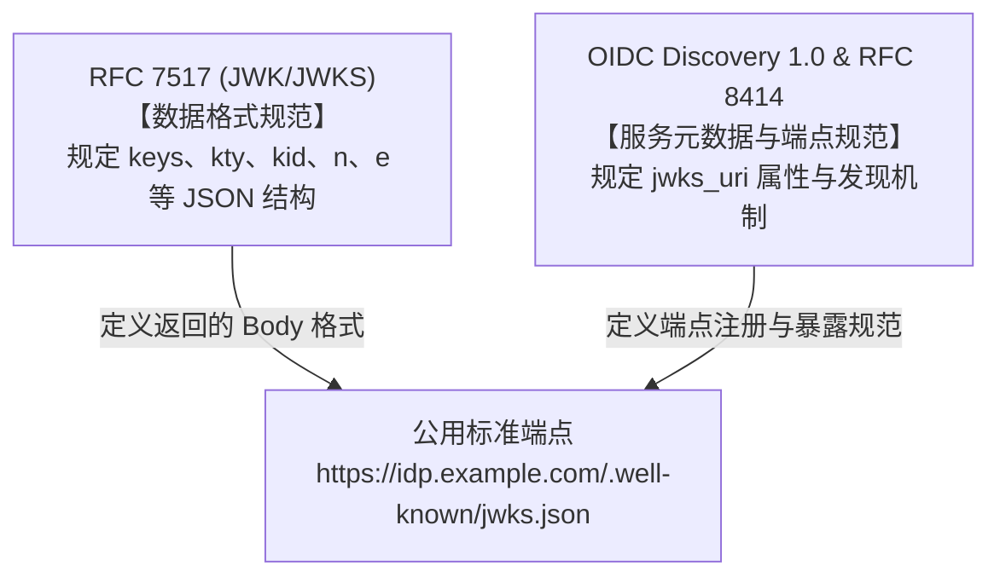
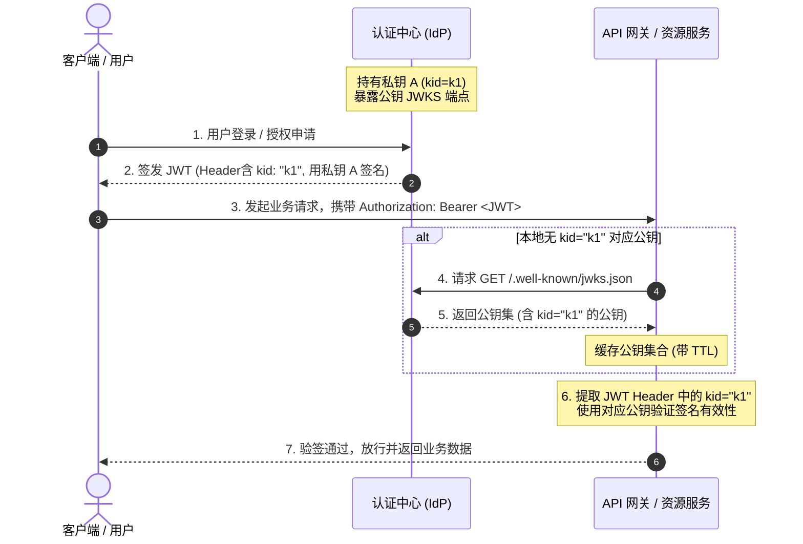

# JWKS（JSON Web Key Set）标准与端点详解

> [!abstract] 核心速览
> - **JWK / JWKS（RFC 7517）**：基于 JSON 格式表示单个加密密钥（JWK）及其集合（JWKS）的**数据结构标准**。
> - **是否为公用标准端点？**：RFC 7517 本身**仅定义数据格式**，未指定 HTTP 端点；将其标准化为公用 HTTP 端点（`jwks_uri`，常见路径为 `/.well-known/jwks.json`）的是 **OIDC Discovery 1.0** 与 **RFC 8414（OAuth 2.0 授权服务器元数据）**。
> - **核心价值**：为分布式微服务与 API 网关提供**动态公钥分发**能力，支撑**零停机平滑密钥轮换（Key Rotation）**。

---

## 一、基本概念与关系

### 1. JWK 与 JWKS
* **JWK（JSON Web Key，RFC 7517）**：一种用于表示加密密钥的 JSON 数据结构。在认证授权系统中，主要用于标准化表达**非对称加密的公钥**（如 RSA、椭圆曲线 EC）。
* **JWKS（JSON Web Key Set）**：多个 JWK 的集合，数据格式表现为一个包含 `keys` 数组的顶级 JSON 对象。

### 2. JOSE 规范体系中的定位
JWK/JWKS 是 IETF 发布的 **JOSE（Javascript Object Signing and Encryption）** 标准套件的重要组成部分：

| 标准 | 名称 | 职责说明 |
| :--- | :--- | :--- |
| **RFC 7515** | **JWS** (JSON Web Signature) | 定义数据的数字签名与 MAC 校验格式 |
| **RFC 7516** | **JWE** (JSON Web Encryption) | 定义数据的加密与解密格式 |
| **RFC 7517** | **JWK / JWKS** | **定义公私钥的 JSON 数据表示与密钥集标准** |
| **RFC 7518** | **JWA** (JSON Web Algorithms) | 定义 JOSE 所使用的加密算法名称与参数枚举 |
| **RFC 7519** | **JWT** (JSON Web Token) | 基于 JWS/JWE 承载声明（Claims）的令牌标准 |

---

## 二、规范澄清：RFC 7517 与公用标准端点

很多人常将“JWKS”直接指代为认证服务器上的公开 URL（如 `/.well-known/jwks.json`），但在标准层面上需要区分为两个层次：



1. **RFC 7517（数据层）**：只规范了 JSON 对象的字段定义、类型与序列化方法，**并未约束必须以哪个 HTTP URI 暴露**。
2. **OIDC Discovery & RFC 8414（协议/传输层）**：
   * 在 OAuth 2.0 / OIDC 体系中，授权服务器通过统一的元数据发现端点暴露自身能力：
     `GET /.well-known/openid-configuration` 或 `GET /.well-known/oauth-authorization-server`
   * 元数据中必须/推荐包含字段 **`jwks_uri`**：
     ```json
     {
       "issuer": "https://auth.company.com",
       "authorization_endpoint": "https://auth.company.com/oauth2/authorize",
       "token_endpoint": "https://auth.company.com/oauth2/token",
       "jwks_uri": "https://auth.company.com/.well-known/jwks.json"
     }
     ```
   * 业界约定俗成的公开默认路径通常为 `/.well-known/jwks.json`。

---

## 三、JWKS 报文结构与核心参数

访问 `jwks_uri` 端点时，服务器会以 `Content-Type: application/json` 返回公开的密钥集信息（**注意：仅发布公钥，严禁泄漏私钥参数**）。

### 1. 典型报文示例（RSA 与 EC 混编）

```json
{
  "keys": [
    {
      "kty": "RSA",
      "use": "sig",
      "alg": "RS256",
      "kid": "auth-key-2026a",
      "n": "u1W1toq87d4yXyZ0...",
      "e": "AQAB"
    },
    {
      "kty": "EC",
      "use": "sig",
      "alg": "ES256",
      "crv": "P-256",
      "kid": "auth-key-2026b",
      "x": "f83OJ3D2xF1Bg8vub9tLe1gHMzV76e8Tus9uPHvRVEU",
      "y": "x_daQpqAhcsfqTSGg8KsOM7-MgUZHVmgZXKaf7Mr48E"
    }
  ]
}
```

### 2. 参数字段说明表

| 参数名 | 全称 | 类型 | 含义与取值说明 |
| :--- | :--- | :--- | :--- |
| **`kty`** | Key Type | 必须 | 密钥类型。如 `RSA`（RSA密钥）、`EC`（椭圆曲线）、`oct`（对称密钥，用于内部） |
| **`use`** | Public Key Use | 可选 | 公钥用途。`sig`（数字签名校验）、`enc`（数据加密） |
| **`key_ops`**| Key Operations | 可选 | 细粒度操作标识数组，如 `["verify"]`、`["encrypt"]`（与 `use` 互斥） |
| **`alg`** | Algorithm | 可选 | 该密钥预期的签名/加密算法，如 `RS256`、`ES256` |
| **`kid`** | Key ID | 推荐 | **密钥唯一标识符**。用于跟 JWT Header 中的 `kid` 对应 |
| **`n`** | Modulus | RSA必填 | RSA 模数（Modulus），Base64URL 编码的大整数 |
| **`e`** | Exponent | RSA必填 | RSA 公钥指数（Exponent），通常固定为 `AQAB`（即 65537） |
| **`crv`** | Curve | EC必填 | 椭圆曲线类型，如 `P-256`、`P-384`、`P-521`、`Ed25519` |
| **`x` / `y`** | Coordinates | EC必填 | 椭圆曲线公钥的 X 与 Y 仿射坐标点（Base64URL 编码） |
| **`x5c`** | X.509 Cert Chain| 可选 | 包含对应的 X.509 证书链（DER 格式经 Base64 编码的字符串数组） |
| **`x5t`** | X.509 Thumbprint| 可选 | 对应 X.509 证书的 SHA-1 指纹（Base64URL 编码） |

> [!warning] 安全红线
> 公开的 JWKS 端点绝对不可包含私钥参数（如 RSA 的 `d`, `p`, `q`, `dp`, `dq`, `qi`，或 EC 的 `d`）。

---

## 四、核心工作机制与实战场景

### 1. 签名分发与验签链路



### 2. 平滑密钥轮换（Key Rotation）

在生产环境中，出于安全合规要求（如每 90 天轮换一次密钥）或发生私钥泄露应急时，JWKS 提供了**零停机、无感轮换**的标准解决方案：

1. **发布阶段**：IdP 生成新的密钥对 `k2`。将公钥 `k2` 加入到 JWKS 端点的 `keys` 列表中（此时端点同时包含 `k1` 和 `k2`）。
2. **切换阶段**：IdP 签发新 JWT 时，改用私钥 `k2` 签名，并在 Header 标记 `kid: "k2"`。旧客户端携带的 `k1` Token 在过期前依然有效。
3. **网关处理**：资源网关收到带有 `kid="k2"` 的 Token 时，如本地缓存未命中，自动触发向 JWKS 端点刷新公钥，命中 `k2` 公钥并成功验签。
4. **废弃阶段**：当所有 `k1` Token 达到生命周期（TTL）上限后，IdP 从 JWKS 列表中移除 `k1` 公钥，完成平滑过渡。

---

## 五、工程落地最佳实践与安全防护

### 1. 客户端与网关缓存策略
- **必须使用内存缓存**：不能每次收到请求都去拉取一次 JWKS 端点，避免造成 IdP 性能瘫痪及网关延迟剧增。
- **动态按需刷新（Stale-While-Revalidate / Cache Miss Fetch）**：
  - 正常设置公钥缓存 TTL（如 12~24 小时）。
  - 当且仅当收到一个未知的 `kid` 时，触发一次主动拉取。

### 2. 防御 JWKS 缓存穿透攻击（DDoS 防护）
> [!caution] 关键漏洞防御
> 如果攻击者大量伪造包含随机不存在 `kid` 的伪造 JWT（如 `kid: "uuid-1234"`），若网关每次未命中均调用一次远程 JWKS 端点，极易造成 IdP 被打垮。
> **防御措施**：
> 1. 对未命中 `kid` 的远程拉取施加**速率限制（Rate Limiting）**（例如每 10 秒最多请求一次 IdP）。
> 2. 对不存在的 `kid` 记录短期负缓存（Negative Caching）。

### 3. 严格校验算法与白名单
- 资源服务器在校验时，必须**根据网关配置预设算法白名单**（如仅允许 `RS256`、`ES256`），禁止直接信任 JWT Header 中的 `alg`，杜绝 `alg: none` 越权漏洞或 RSA/HMAC 密钥混淆攻击。
- 端点传输强制全链路 HTTPS。

---

## 六、标准与参考规范

- **IETF RFC 7517**: [JSON Web Key (JWK)](https://datatracker.ietf.org/doc/html/rfc7517)
- **IETF RFC 8414**: [OAuth 2.0 Authorization Server Metadata](https://datatracker.ietf.org/doc/html/rfc8414)
- **OpenID Foundation**: [OpenID Connect Discovery 1.0](https://openid.net/specs/openid-connect-discovery-1_0.html)
- **IETF RFC 7515**: [JSON Web Signature (JWS)](https://datatracker.ietf.org/doc/html/rfc7515)
- [[证书相关名词与概念]]
