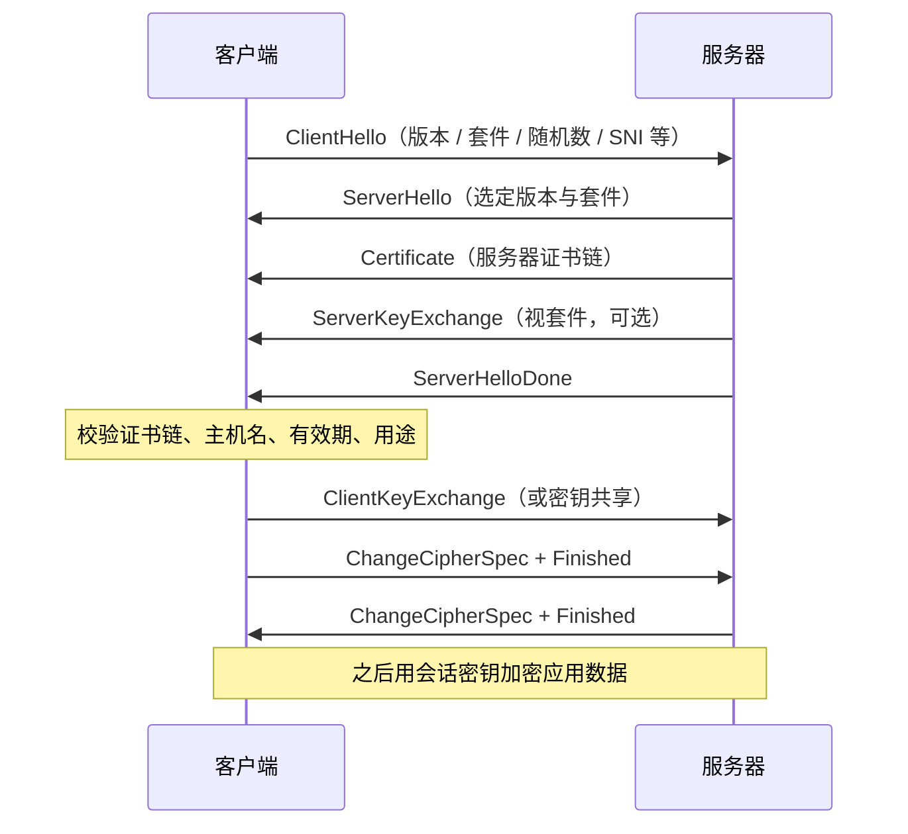
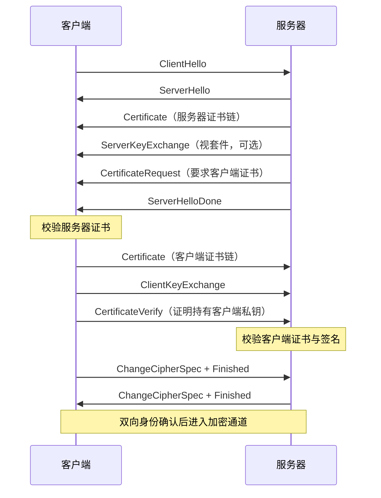
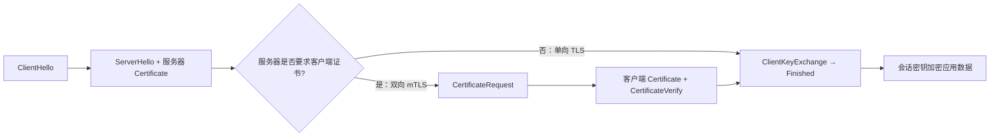
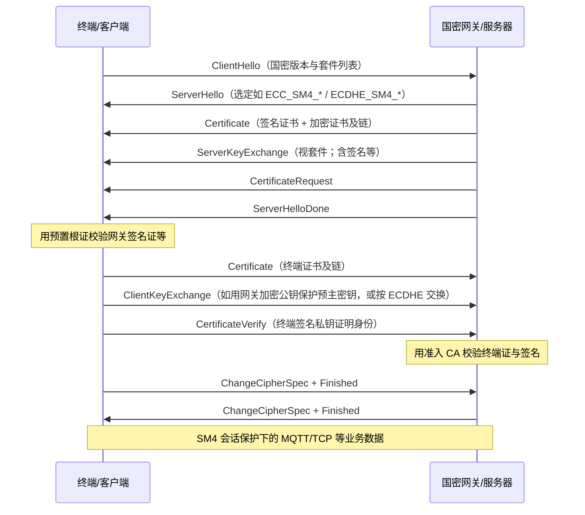

# TLS 知识梳理

> 结合国密双向 TLS、终端证书、国密网关场景整理，和《PKI知识梳理》配套阅读。

## 1. TLS 是什么

TLS（Transport Layer Security，传输层安全）是在 TCP 之上的加密协议，用来保证：

- **身份认证**：确认对方是谁
- **加密传输**：别人偷看也看不懂
- **完整性**：报文被改会立刻发现

HTTPS、安全 MQTT、很多 VPN / 网关通道，底层都是 TLS。

一句话：TLS 在「明文业务协议」外面套上一层可信加密通道。

## 2. TLS 和 PKI 的关系

TLS 负责「怎么建安全连接」；PKI 负责「证书和身份从哪来」。

| 概念 | 作用 |
|------|------|
| PKI / CA | 签发证书，证明公钥属于某个设备或服务器 |
| 证书 + 私钥 | 握手时证明身份、协商密钥 |
| TLS | 用证书完成握手，之后用会话密钥加密业务数据 |

没有证书体系，TLS 也能加密，但很难可靠地证明「对面到底是谁」。车联网国密场景里，证书来自 PKI，通道靠 TLS。

## 3. 单向 TLS 和双向 TLS

认证方向决定「谁要证明自己是谁」。单向只让服务器证明身份；双向要求客户端也出示证书。车联网国密网关、服务间调用里常见双向；浏览器访问公网网站大多是单向。细节与证书链、主机名校验等概念见 [[证书相关名词与概念|证书相关名词与概念]]、[[PKI知识梳理|PKI知识梳理]]。

### 3.1 单向 TLS（server-only / one-way TLS）

**是什么**：只有服务器向客户端出示证书并完成身份证明；客户端一般不提供证书。服务器通常用账号密码、Token、Cookie 等应用层手段识别用户，而不是 TLS 层的客户端证书。

**握手轮廓（简化，TLS 1.2 思路；1.3 消息合并更多，语义类似）**：

1. **ClientHello**：客户端发起连接，声明支持的协议版本、密码套件、扩展（如 SNI）等。
2. **ServerHello**：服务器选定协议版本与密码套件。
3. **Certificate**：服务器发送自身证书（通常含中间证书链）。
4. **密钥交换相关消息**：服务器可能发送 ServerKeyExchange；随后 ServerHelloDone。客户端校验服务器证书通过后，发送 ClientKeyExchange（或等价的密钥共享），双方据此派生**会话密钥**。
5. **ChangeCipherSpec + Finished**：双方切换到协商好的加密参数，用 Finished 消息确认握手未被篡改。之后业务数据用会话密钥加密。

（TLS 1.3 把证书、密钥共享等多步收进更少的飞行轮次，但「服务器出示证书 → 客户端校验 → 协商会话密钥」这一顺序不变。）

**握手时序（单向，TLS 1.2 风格示意）**：



**客户端要校验什么**：

| 校验项 | 含义 |
|--------|------|
| 证书链 | 叶证书能追溯到客户端信任库中的根 / 中间 CA |
| 主机名（或标识） | 证书 SAN / CN 与要访问的域名或约定标识一致（SNI 应对应目标主机） |
| 有效期 | 当前时间落在 notBefore～notAfter 内 |
| 用途与状态 | KeyUsage / EKU 符合服务器认证；按策略检查吊销（CRL / OCSP，视部署而定） |
| 握手签名 / 密钥证明 | 对端确实持有与证书公钥匹配的私钥 |

**典型用途**：公网 HTTPS 网站、普通 API 的 TLS 终结、仅需「防窃听 + 确认服务器身份」的通道。

**常见坑**：

- 只开了 443 / 8883，但未正确校验证书链或关闭了主机名校验 → 易被中间人冒充
- 证书过期、链不完整（缺中间证）、SNI 与证书域名不一致 → 握手失败或被错误放行
- 把「能加密」当成「已认证」：单向 TLS 不证明客户端身份
- 自签证书未导入信任库，或生产误用测试 CA

### 3.2 双向 TLS（mTLS / mutual TLS）

**是什么**：在单向基础上，**服务器也要求并校验客户端证书**。双方都用证书 + 私钥证明身份，再协商会话密钥。文档里的「终端 ↔ 国密网关」就是双向 TLS。

**与单向的差别**：

| 维度 | 单向 TLS | 双向 TLS（mTLS） |
|------|----------|------------------|
| 谁出示证书 | 仅服务器 | 服务器 + 客户端 |
| 身份结论 | 客户端可信服务器；服务器通常不知客户端「证书身份」 | 双方在 TLS 层互相确认证书身份 |
| 握手额外步骤 | 无客户端证书交换 | 服务器发 CertificateRequest；客户端回传证书并证明持有私钥 |
| 典型信任材料 | 客户端信任库含服务器 CA | 双方各自信任对方证书的签发 CA |
| 常见配套 | 应用层登录 / Token | 设备证书、服务账号证书、网关准入 |

**握手中与客户端证书相关的部分（在单向流程上的增量）**：

1. 服务器在出示自己的证书之后（或 TLS 1.3 的对应阶段），发送 **CertificateRequest**，表明需要客户端证书，并可提示可接受的 CA。
2. 客户端发送 **Certificate**（设备证 / 服务证及必要链），再发送证明持有私钥的消息（如 CertificateVerify）。
3. 服务器用自身信任的 CA 校验客户端证书链、有效期、用途，并核对私钥证明；不通过则中止握手。
4. 其余 Finished 与会话密钥派生与单向相同；通过后进入加密的业务通道。

**握手时序（双向 mTLS，TLS 1.2 风格示意）**：



**单向 vs 双向（流程对照）**：



**各方校验什么**：

| 校验方 | 校验对象 | 通常查什么 |
|--------|----------|------------|
| 客户端 | 服务器证书 | 链、主机名 / 标识、有效期、用途；国密场景还要符合国密套件与网关约定 |
| 服务器 | 客户端证书 | 链是否由准入 CA 签发、有效期、EKU / 策略 OID、是否在吊销 / 黑名单、是否映射到允许的设备或服务身份 |

车端场景（与下文网关、终端准备章节一致）：

| 一方 | 出示什么 | 对方怎么验 |
|------|----------|------------|
| 终端 | 设备证书 | 网关用 CA 根 / 中间证书校验 |
| 国密网关 | 服务器证书 | 终端用预置根证书校验 |

**典型用途**：服务间调用（service-to-service）、高安全 API 网关准入、车联网 / IoT 设备接入、零信任或内网双向鉴权、国密网关前的设备通道。

**常见坑**：

- **客户端证书分发与轮换**：设备多、证书过期未更新 → 成批握手失败；私钥若被拷出则身份可被冒用
- **CA 信任库不一致**：服务器信任的签发 CA 与客户端证书实际签发方不一致，或终端未预置正确根证
- **吊销与挂起未生效**：仅验链和有效期、不查 CRL / OCSP / 本地黑名单 → 已吊销设备仍可能连上（策略与性能需权衡）
- 误把单向当成双向：网关未开 CertificateRequest，或客户端未配置证书，表面「TLS 通了」但未做设备级准入
- 证书用途不对（如用了仅签名策略的证去做客户端认证）、链不完整、密码机 / 密码卡中私钥与证书不匹配

## 4. TLS 握手在干什么（简化）

1. 客户端发起连接，告诉对方支持的算法套件。
2. 服务器返回证书（双向时还会向客户端要证书）。
3. 双方用证书和私钥完成身份校验。
4. 协商出本次连接的**会话密钥**（对称密钥，速度快）。
5. 之后业务数据都用会话密钥加密传输。

证书和私钥主要用在握手阶段；真正批量加密靠会话密钥。

## 5. 证书、私钥、会话密钥分别干什么

| 材料 | 谁持有 | 作用 |
|------|--------|------|
| 根证书 | 终端预置、网关信任库 | 验对方证书是不是自家 CA 签的 |
| 设备 / 服务器证书 | 各自持有 | 对外证明身份，里面有公钥 |
| 私钥 | 各自本地，不外传 | 证明「我确实拥有这张证书」 |
| 会话密钥 | 本次连接临时生成 | 加密后续 MQTT / TCP 业务报文 |

记住：私钥不出设备；会话密钥连一次换一次。

## 6. 业务协议怎么跑在 TLS 上

终端连云端时，常见不是「裸 MQTT / 裸 TCP」，而是：

```text
终端 --(国密双向 TLS)-- 国密网关 --(内网/业务转发)-- TSP / 业务系统
              ↑
         MQTT 或 TCP 报文跑在 TLS 通道里
```

| 协议 | 常见端口 | 说明 |
|------|----------|------|
| MQTT over TLS | 8883 | 先 TLS，再在里面跑 MQTT |
| 自定义 TCP over TLS | 视项目而定 | 先 TLS，再跑业务帧 |

TLS 解决安全和身份；MQTT / TCP 只负责业务内容。

## 7. 国密 TLS（GMTLS / TLCP）认证流程

国内车联网、政务、金融等场景常要求用商用密码算法建立传输层安全通道。行业里常称 **国密 TLS / GMTLS / 国密 SSL**；国家标准侧对应 **GB/T 38636（TLCP，传输层密码协议）**，密码行业标准有 **GM/T 0024（SSL VPN 技术规范）** 等。它们借鉴 TLS 1.1/1.2 的握手骨架，但算法、证书模型和部分密钥交换语义与国际 TLS 并不相同，不能简单当成「把 RSA/AES 换成 SM2/SM4 的普通 TLS」。

算法对照：

| 项目 | 国际常见 | 国密常见 |
|------|----------|----------|
| 非对称算法 | RSA / ECDSA | SM2（椭圆曲线） |
| 哈希 / 完整性 | SHA-256 等 | SM3 |
| 对称加密 | AES（CBC/GCM 等） | SM4（CBC / GCM，视标准与实现） |
| 协议形态 | TLS 1.2 / 1.3 | 国密 TLS（GMTLS）/ TLCP |

文档里的「国密网关」即支持上述算法与（多为）双向认证的安全网关。证书角色、KM、网关职责见 [[PKI知识梳理|PKI知识梳理]]；算法与证书名词见 [[证书相关名词与概念|证书相关名词与概念]]。

### 7.1 双证书模型（签名证 + 加密证）

国密传输层协议普遍采用 **双证书**，而不是国际 HTTPS 里常见的「一张服务器证打天下」：

| 证书 | 作用 | 密钥来源（规范常见做法） |
|------|------|--------------------------|
| **签名证书** | 身份鉴别：对握手消息签名，证明「我是证书主体」 | 签名密钥对多由实体本地密码模块生成，再向 CA 申请签发 |
| **加密证书** | 密钥协商 / 加密：参与预主密钥保护或 SM2 密钥交换 | 加密密钥对常由 CA 侧 **KM（密钥管理中心）** 生成，再安全下发给实体 |

服务器在 Certificate 阶段通常会带上 **签名证书 + 加密证书**（及必要链）。客户端在双向、且套件要求时，同样可能需要签名证（认证）以及加密证（如 ECDHE 类协商）。具体以对接的 CA、网关和选定密码套件为准。

注意：这与「站点同时挂一张 RSA 证 + 一张 SM2 证做国际/国密双栈兼容」不是同一件事；这里说的是 **国密协议内部的签名/加密职责分离**。

### 7.2 常见密码套件（名称以国标 / 行标常用写法为准）

GB/T 38636（TLCP）等文档中，套件名一般按「密钥交换_对称算法_模式_校验」组织。实现与网关日志里常见写法包括（CBC / GCM 成对出现）：

| 套件名（常见写法） | 密钥交换要点 | 认证倾向 |
|--------------------|--------------|----------|
| `ECC_SM4_CBC_SM3` / `ECC_SM4_GCM_SM3` | 客户端生成预主密钥，用**服务器加密证书公钥**（SM2 加密）保护后发给服务器 | 可单向或双向（是否要客户端证由服务器 CertificateRequest 决定） |
| `ECDHE_SM4_CBC_SM3` / `ECDHE_SM4_GCM_SM3` | 双方按 SM2 密钥交换协商共享密钥作预主密钥；需交换临时公钥等参数 | 规范语义上侧重**双向**；通常要求双方具备签名/加密相关密钥材料 |
| `RSA_SM4_*`、`IBC_*` / `IBSDH_*` 等 | 另有 RSA 或标识密码（SM9）路径 | 视产品是否实现；车联网网关场景更常见 SM2 的 ECC / ECDHE 类 |

不同厂商、OpenSSL 国密分支（如 Tongsuo / TASSL / GmSSL 等）在日志里的字符串可能写成 `ECC-SM2-SM4-CBC-SM3` 等形式，**以实际握手协商结果与产品文档为准**，不要只凭别名猜测能力。

### 7.3 单向国密 TLS 握手轮廓（相对国际 TLS 的差异）

消息名字仍类似 ClientHello / ServerHello / Certificate / … / Finished，但要点不同：

1. **Hello**：协商的是国密协议版本与国密套件（如 `ECC_SM4_*`），不是普通 `TLS_AES_*` / `ECDHE_RSA_*`。
2. **服务器 Certificate**：通常包含**签名证书 + 加密证书**（双证），而不只是一张认证用服务器证。
3. **密钥交换（以 ECC 类为例）**：客户端用服务器**加密证书**的公钥保护预主密钥（或按套件做 SM2 相关交换）；服务器用对应加密私钥解开。签名证书主要用于身份证明与对关键握手参数的签名，而不是替代加密证做预主密钥封装。
4. **Finished**：双方用派生出的工作密钥确认握手完整；之后 SM4 保护应用数据。

与国际单向 TLS 对比：国际常见「一张服务器证 +（ECDHE 临时密钥或 RSA 解密预主密钥）」；国密 ECC 路径明确拆成签名/加密双证，且算法固定在 SM2/SM3/SM4 体系。

### 7.4 双向国密 TLS（国密 mTLS）

车端 ↔ 国密网关场景通常是 **国密双向 TLS**：

1. 服务器在双证之后发送 **CertificateRequest**。
2. 客户端返回设备/终端证书（按套件与策略，可能涉及签名证，ECDHE 类还可能涉及加密侧材料），并发送 **CertificateVerify**（用签名私钥证明持有者身份）。
3. 网关用准入 CA 校验客户端证书；终端用预置根证校验网关服务器证。
4. 选定套件完成预主密钥协商 → 主密钥 / 工作密钥 → Finished → 在通道上跑 MQTT/TCP 等业务。

**国密双向握手时序（ECC 类 + 要求客户端证，示意）**：



### 7.5 部署要点（网关 / 客户端 / 车联网）

- **网关**：在密码卡/密码机中配置服务器签名密钥与加密密钥及对应证书；信任终端签发 CA；开启双向认证；对外终结国密 TLS，对内转发 TSP/业务系统（见 [[PKI知识梳理|PKI知识梳理]] 中国密网关角色）。
- **终端 / IoT**：预置根证；申请并安装设备证；客户端协议栈须支持国密套件（普通仅国际 TLS 的浏览器/库往往无法直接对接通专用国密网关）。
- **国密浏览器 / 双栈站点**：公网 HTTPS 若要同时服务国际与国密访问，常见是网关或服务器做协议/证书双栈，与「单条连接内的签名+加密双证」分层理解。
- **套件选择**：只做网关验设备、客户端用加密公钥保护预主密钥时，ECC 类较常见；若产品与策略要求双方参与 SM2 密钥交换，才上 ECDHE 类，并确认两端双证材料齐全。

### 7.6 常见坑

- 把国密 TLS 当成「国际 TLS + SM 算法插件」：Hello 版本、双证书、密钥交换语义不匹配 → 一直握手失败。
- 只装了签名证、漏了加密证（或加密私钥与证书不一致）→ ECC 类协商失败。
- 客户端仍是标准 OpenSSL/浏览器，未换国密协议栈或未启用国密套件。
- 双向未真正开启：无 CertificateRequest 或终端未带设备证，通道「能加密」但无设备级准入。
- CA / 根证与 KM 流程脱节：加密证未按 KM 规范下发、信任库与签发链不一致。
- 证书过期、吊销未生效、密码机中私钥与对外证书不匹配（与第 10、11 节同类问题，国密场景更常踩在双证与套件上）。

具体字段、厂商差异和对接步骤以项目 CA、网关文档为准；本笔记只梳理通用认证流程。

## 8. 终端侧要准备什么

1. 预置 CA 根证书
2. 生成本地密钥对和 P10，申请并安装设备证书
3. 连接网关时启用双向 TLS / 国密 TLS
4. 用设备证书和私钥完成握手
5. 握手成功后再发 MQTT / TCP 业务数据

没有设备证书之前，一般只能走申请、下载流程，不能当正式业务连接。

## 9. 网关侧要准备什么

1. 安装服务器证书和私钥（通常在密码卡 / 密码机中）
2. 安装同一套 CA 根 / 中间证书，用来验终端
3. 开启双向认证
4. 把通过认证的连接和报文转到 TSP / 业务系统

网关不签发证书，也不保存终端私钥。

## 10. 和证书生命周期的关系

| 证书状态 | 对 TLS 的影响 |
|----------|----------------|
| 有效 | 可以正常握手 |
| 过期未更新 | 握手失败，需要先更新证书 |
| 吊销 / 挂起 | 网关校验失败，应拒绝连接 |
| 根证书轮换 | 终端和网关都要更新信任的根 |

所以 TLS 通不通，不只看网络，还看证书是否在有效状态。

## 11. 常见误区

| 误区 | 正解 |
|------|------|
| TLS 就是加密，不用管证书 | 加密只是一半，身份认证同样关键 |
| 装了根证书就能当设备证书用 | 根证书只用来验别人；设备还要自己的证书和私钥 |
| MQTT 端口改成 8883 就安全了 | 还必须正确配置证书和双向校验 |
| 网关和终端可以各信不同的根 | 同一套体系里应信任同一条 CA 链 |
| 私钥可以备份到服务器方便运维 | 私钥应留在终端 / 密码模块内 |

## 12. 速记

- TLS = 安全通道；PKI = 证书和身份来源。
- 车端对接网关，通常是**双向 TLS**。
- 根证书用来验对方；设备证书用来证明自己。
- 私钥本地生成、本地保存、永不外传。
- MQTT / TCP 跑在 TLS 之上，不替代 TLS。
- 国密场景换成 SM2 / SM3 / SM4，并走支持国密的网关。

## 相关文档

- [[PKI知识梳理|PKI知识梳理]]：证书角色、TSP、国密网关、申请流程、双证书与 KM
- [[证书相关名词与概念|证书相关名词与概念]]：SM2/SM3、证书字段与国密相关名词
