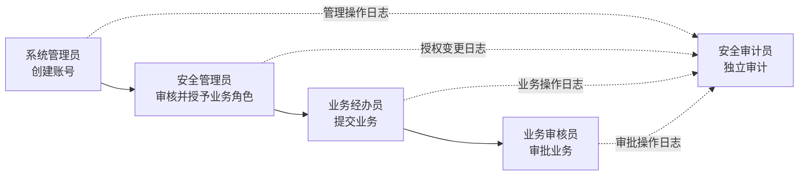

# Web 系统三权分立与业务权限隔离

## 一、概念说明

在常规 Web 系统中，“三权分立”通常是指将高风险的系统管理权限拆分给三类相互独立、相互制约的角色，避免同一账号同时拥有系统配置、权限授予和审计监督能力。

常见的三类角色是：

1. **系统管理员**：管理系统资源和基础配置。
2. **安全管理员**：管理身份、角色、授权和安全策略。
3. **安全审计员**：检查系统操作、授权变更和安全事件。

> [!important] 核心目的
> 三权分立的本质不是简单地创建三个角色，而是确保关键操作无法由一个人或一个账号独立完成，并且操作过程可追溯、可监督、不可抵赖。

这里的“三权分立”借用了权力制衡思想，并不是国家治理中立法权、行政权和司法权在 Web 系统中的直接对应。不同单位也可能使用“系统管理员、安全保密管理员、安全审计员”或“系统管理、权限管理、审计监督”等名称。

## 二、三类管理角色的职责

| 角色 | 主要职责 | 通常允许的操作 | 原则上禁止的操作 |
| --- | --- | --- | --- |
| 系统管理员 | 系统运行和基础资源管理 | 用户基础信息维护、组织机构维护、系统参数配置、运行维护 | 给自己授予敏感权限、审批自身操作、修改或删除审计记录 |
| 安全管理员 | 身份与访问权限管理 | 角色管理、权限分配、账号安全策略、敏感权限审批或复核 | 直接办理具体业务、绕过审批授权、修改审计记录 |
| 安全审计员 | 独立监督和审计 | 查看登录日志、操作日志、授权记录和安全事件，出具审计报告 | 修改业务数据、管理用户权限、修改或删除原始审计记录 |

实际权限边界应根据系统性质和组织制度确定。例如，有些系统由系统管理员创建账号、安全管理员授予角色；另一些系统会把账号全生命周期也交由安全管理员负责。无论如何划分，都应避免角色之间形成不受监督的权限闭环。

## 三、三权账号是否办理具体业务

### 3.1 一般原则

三类管理账号原则上不直接办理具体业务。

三权分立主要解决的是系统“由谁管理、由谁授权、由谁监督”的问题；业务系统中的业务录入、业务审批和业务复核属于另一套业务权限体系。

| 账号类型 | 主要职责 | 是否办理具体业务 |
| --- | --- | --- |
| 系统管理员 | 用户、组织、参数和系统运行维护 | 原则上不办理 |
| 安全管理员 | 角色授权、安全策略和敏感权限管理 | 原则上不办理 |
| 安全审计员 | 日志审计、风险检查和审计报告 | 不办理 |
| 业务经办员 | 新增、修改、提交业务数据 | 可以 |
| 业务审批员 | 审核、批准或驳回业务申请 | 可以 |
| 业务复核员 | 复核关键业务过程或结果 | 可以 |

> [!note] 管理控制面与业务数据面
> 管理账号负责系统的“控制面”，业务账号负责具体业务的“数据面”。两类权限应分别建模、分别授权并分别审计。

### 3.2 人员、账号和角色要分开理解

- **人员**：现实中的自然人，例如张三。
- **账号**：人员登录系统时使用的身份，例如 `zhangsan-admin`、`zhangsan-biz`。
- **角色**：账号在系统中被授予的权限集合，例如系统管理员、业务审核员。

在人员有限的情况下，同一自然人可能同时承担管理职责和业务职责，但建议使用不同账号或不同身份入口：

- 管理账号只进入管理后台，业务账号只进入业务功能区。
- 两类账号分别申请、审批、授权和记录日志。
- 管理身份与业务身份不应在同一会话中无感切换。
- 高安全等级系统应进一步限制人员兼任，而不只是做账号分离。

账号分离只能降低误操作和身份混用风险，不能完全消除同一人员兼任造成的利益冲突。

## 四、典型业务场景

以车辆资质审核系统为例：

| 环节 | 执行角色 | 典型操作 |
| --- | --- | --- |
| 账号创建 | 系统管理员 | 创建用户、维护所属组织 |
| 权限授予 | 安全管理员 | 授予“资质经办员”或“资质审核员”角色 |
| 材料提交 | 业务经办员 | 填写并提交车辆资质材料 |
| 业务审核 | 业务审核员 | 审核、批准或驳回申请 |
| 监督检查 | 安全审计员 | 检查账号创建、授权、提交和审核记录 |

## 五、应遵循的控制原则

### 5.1 职责和权限互斥

- 系统管理员不能给自己授予敏感权限。
- 权限申请、审批和执行不应由同一人独立完成。
- 安全管理员即使可以授予业务权限，也不应直接办理对应业务。
- 安全审计员不能兼具被审计对象的管理权限。
- 同一笔业务的经办人与审批人原则上不能是同一个人。
- 特别敏感业务可增加复核员，实行双人复核或双人授权。

### 5.2 最小权限

- 账号只拥有完成当前职责所需的最小权限。
- 权限应尽量限定到菜单、按钮、数据范围和操作类型。
- 高风险权限应设置有效期，到期自动回收。
- 人员转岗、离职或职责变化后应及时调整权限。

### 5.3 独立审计

- 登录、授权、配置变更、数据修改、数据导出和审批等操作应全程留痕。
- 日志至少应记录操作者、时间、来源、对象、动作和结果。
- 操作者不能修改或删除自己的日志。
- 审计日志宜集中存储，并采取防篡改、访问控制、备份和留存期限管理措施。
- 审计员对异常授权、越权访问、批量导出和日志缺失等情况进行检查。

### 5.4 高风险操作的二次控制

以下操作不宜仅凭一个高权限账号直接完成：

- 超级管理员或敏感角色授予。
- 批量数据导出和敏感数据下载。
- 安全策略关闭或降低。
- 审计配置和日志留存策略修改。
- 大批量删除、数据修复和不可逆操作。

可采用审批、双人复核、二次认证、操作原因填写、临时授权和自动失效等控制措施。

## 六、紧急权限处理

生产故障或重大业务异常可能需要临时突破常规权限边界。此类“紧急账号”或“破窗权限”应满足：

1. 使用前有明确的申请理由和审批人。
2. 权限范围和有效期尽可能小。
3. 启用强认证并对操作进行完整记录。
4. 到期自动回收，不转化为永久权限。
5. 事后由独立人员复核操作记录和处理结果。

## 七、系统落地建议

### 7.1 权限模型

可使用 RBAC（基于角色的访问控制）作为基础，并补充以下能力：

- 管理角色与业务角色分类管理。
- 互斥角色校验，阻止冲突角色同时授予。
- 菜单权限、操作权限和数据权限分层控制。
- 敏感权限审批、有效期和自动回收。
- 定期权限复核和长期未使用权限清理。

### 7.2 账号和认证

- 禁止多人共用管理员账号，确保责任能够落实到个人。
- 管理账号启用多因素认证和更严格的登录策略。
- 限制管理后台的访问来源、时间或终端范围。
- 超级账号仅用于初始化或应急处理，日常操作使用受限管理员账号。
- 服务账号、接口账号与人员账号分开管理，避免交叉使用。

### 7.3 审批与审计

- 保存权限申请、审批、授予、变更和回收的完整链路。
- 对管理员登录、角色变更、策略变更和敏感业务操作进行告警。
- 定期生成管理员权限清单、互斥角色冲突清单和异常操作报告。
- 审计查询权限与日志管理权限分离；如确需清理日志，应经过审批并保留清理记录。

## 八、常见误区

### 误区一：创建三个角色就实现了三权分立

如果三个角色最终由同一账号持有，或者可以互相随意授权，仍然没有形成有效制约。还需要落实人员或账号隔离、互斥校验、审批和审计。

### 误区二：管理员权限越大，运维越方便

长期使用超级管理员账号虽然方便，但会扩大误操作、越权和账号泄露的影响范围。日常管理应使用最小权限账号。

### 误区三：管理员不能查看任何业务数据

系统维护有时确实需要查看有限的业务信息。应按工作需要提供脱敏、只读、按范围或临时授权能力，而不是默认开放全部业务数据。

### 误区四：同一人使用两个账号就一定合规

账号分离有助于区分操作场景，但同一自然人仍可能形成利益冲突。对于高风险系统，应优先由不同人员分别承担管理、授权和审计职责。

### 误区五：业务审批属于三权分立中的“审批权”

业务经办、业务审批和业务复核属于业务流程控制；系统管理、安全授权和安全审计属于管理权限制衡。两者可以同时存在，但不应混为同一套角色体系。

## 九、简要结论

常规 Web 系统中较规范的做法可以概括为：

> [!summary]
> **三权账号管系统，业务账号办业务；管理、授权、审计相互制约，经办、审批、复核相互分离。**

具体落地时，应根据系统安全等级、业务风险、组织规模和合规要求确定角色数量及人员是否允许兼任。无论采用何种命名，最终都应达到权限不过度集中、关键操作相互制约、全部行为可追溯的目标。
