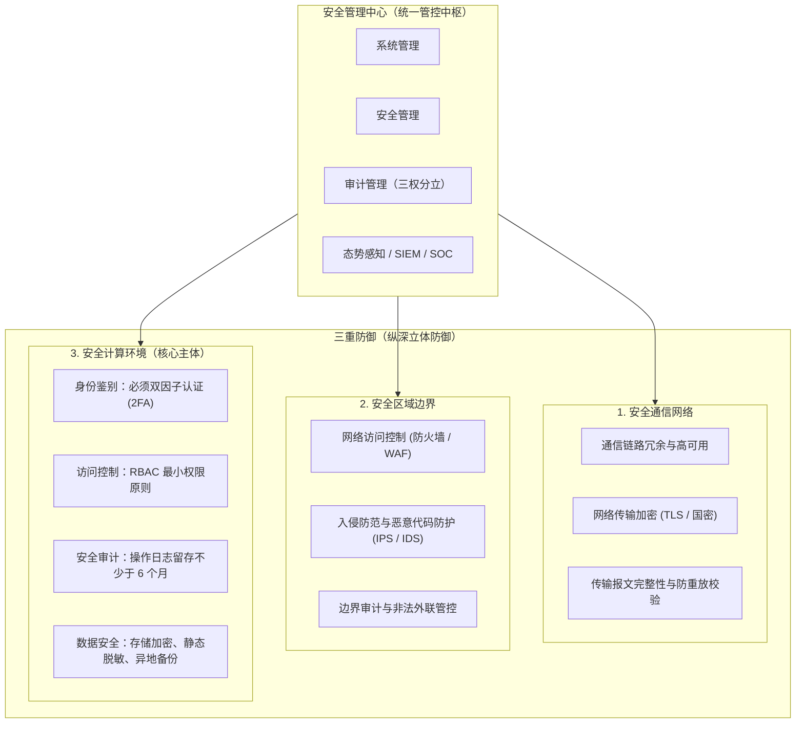
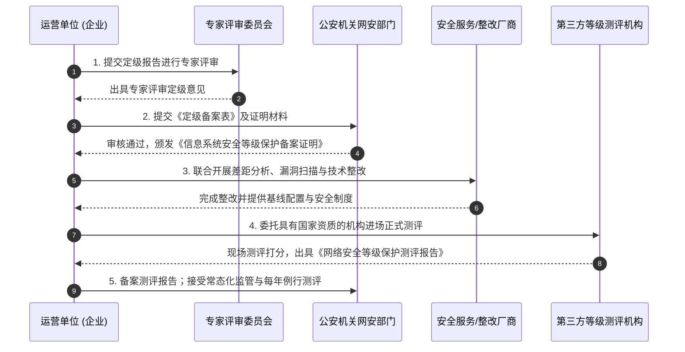

# 网络安全等级保护（等保三级）详解与实施指南

## 一、概述与法律背景

**网络安全等级保护三级**（简称“**等保三级**”），是我国依照国家标准对非涉密信息系统实行的**等级最高、监管最严格的通用安全保护级别之一**。在现行《网络安全等级保护 2.0》（简称“等保 2.0”，核心标准为 GB/T 22239-2019）制度中，等保三级被称为企业与机构信息系统安全建设的**核心分水岭**与**国家级标杆**。

> [!important] 核心法律与法规依据
> 1. **《中华人民共和国网络安全法》第二十一条**：国家实行网络安全等级保护制度。网络运营者应当按照网络安全等级保护制度的要求，履行安全保护义务。
> 2. **《中华人民共和国数据安全法》** 与 **《个人信息保护法》**：将等级保护作为组织落实数据合规与重要数据保护的基线要求。
> 3. **核心国家标准**：
>    * GB/T 22239-2019《信息安全技术 网络安全等级保护基本要求》
>    * GB/T 28448-2019《信息安全技术 网络安全等级保护测评要求》
>    * GB/T 22240-2020《信息安全技术 网络安全等级保护定级指南》

---

## 二、等保五个级别划分与三级定位

根据信息系统在遭到破坏后对**国家安全**、**社会秩序**和**公共利益**，以及公民、法人和其他组织的**合法权益**造成的危害程度，网络安全保护分为一至五级：

| 等级 | 保护级别 | 影响范围与定级特征 | 监管与测评要求 |
| :--- | :--- | :--- | :--- |
| **第一级** | 自主保护级 | 损害公民、组织合法权益，**不损害国家安全与社会公共利益**。如一般小型企业展示性官网。 | 自主定级与防护，无需公安备案或测评。 |
| **第二级** | 指导保护级 | 严重损害合法权益，或**对社会秩序、公共利益造成一般损害**，不危害国家安全。如地市级一般企事业单位内网、普通 OA。 | 公安指导，自主或建议每两年测评一次。 |
| **第三级** | **监督保护级** | **对社会秩序和公共利益造成特别严重损害，或对国家安全造成损害**。金融机构、重要政务、关键民生及车联网监管核心系统。 | **强制向公安网安部门备案，每年至少测评一次。** |
| **第四级** | 强制保护级 | 对国家安全造成特别严重损害。如国家电网调度中心、国家级金融清算骨干网、大型航天测控等。 | 国家专门部门强制监管，每半年至少测评一次。 |
| **第五级** | 专控保护级 | 涉及国家安全绝密级系统（通常转入涉密分级保护体系管理）。 | 国家特定专门机构直接管控。 |

> [!note] 为什么三级是绝大多数企业的天花板？
> 四级和五级通常仅面向国家命脉级基础设施（如国家电网总调、国家重大国防科研）。对于互联网平台、跨国企业、金融科技、SaaS 厂商和政企供应商而言，**等保三级即为实际可申报和要求的最高等级**。

> [!info] 第二级
> Web 平台按第二级建设时的控制项、与三级的分界，见 [[安全/网络安全等级保护（等保二级）详解与实施指南|等保二级详解与实施指南]]。

---

## 三、适用范围与典型定级系统

符合以下特征之一的业务系统，法律法规与行业监管通常**强制要求**按等保三级定级与建设：

1. **金融与交易结算**：商业银行核心业务系统、网上银行、第三方支付结算机构、证券/基金交易平台。
2. **数字政务与核心民生**：省级/地市级政务云平台、电子政务外网核心应用、公积金/社保平台、三甲医院核心 HIS/PACS 系统。
3. **关键信息基础设施与智能监管**：智能网联汽车监管平台、车联网数据安全运营中心、交通信号调度与监控中心、能源水务中枢管理系统。
4. **大型互联网与民生服务平台**：注册用户超千万、存储海量用户敏感隐私（身份证、人脸/指纹、银行卡、精确轨迹）的电商平台、即时通讯、在线医疗或出行打车平台。

---

## 四、等保三级核心防护架构（“一个中心，三重防御”）

等保 2.0 三级标准摒弃了传统的单点被动防御，确立了**“一个中心、三重防御”**（安全管理中心 + 安全计算环境、安全区域边界、安全通信网络）的深度纵深防御体系。

### 1. 安全技术要求细则

#### (1) 安全物理环境
* 关键机房防盗、防火、防雷、温湿度控制、防静电与防电磁泄漏。
* 独立供电（UPS 双路冗余支持满负荷运行足够时长）。
* 机房出入具备双人审批、电子门禁与 7×24 小时监控录像，录像保存不少于 90 天。

#### (2) 安全通信网络
* **网络架构冗余**：核心交换与路由设备双机热备，避免单点故障。
* **传输安全**：管理流量与业务敏感数据传输强制采用加密通道（推荐国密 SM2/SM3/SM4 或强 TLS 协议），具备防重放攻击与报文完整性检验机制。

#### (3) 安全区域边界
* **微隔离与访问控制**：根据业务属性划分子网（DMZ、应用层、数据层、运维管理区），部署 NGFW（下一代防火墙）。
* **入侵检测与防护**：部署 IDS/IPS，检测并阻断端口扫描、网络嗅探、SQL注入、跨站脚本（XSS）等攻击行为。
* **抗 DoS/DDoS 与防恶意代码**：在网关处部署抗拒绝服务设备及反病毒/恶意代码拦截机制。

#### (4) 安全计算环境（核心落地点）
* **身份鉴别**：
  * 对管理用户与特权账号必须采用**双因子认证（2FA）**（如：用户名密码 + 短信动态码/OTP/数字证书/生物特征）。
  * 密码复杂度要求（8位以上，包含大小写、数字、特殊字符混合），定期强制轮换，登录防暴力破解锁定机制。
* **访问控制与三权分立**：
  * 实现基于 RBAC 的最小权限授权。
  * 生产环境严禁超级管理员（root/admin）独揽大权，必须落实**系统管理员、安全管理员、安全审计员**职责分离，详情可参考 [[Web系统三权分立与业务权限隔离]]。
* **安全审计**：
  * 审计范围必须覆盖所有核心服务器、数据库、网络设备及业务系统操作。
  * **法律与测评硬指标：审计记录保存时间不少于 6 个月（180 天）**。
  * 审计记录应集中上报至日志审计系统或堡垒机，防止被运维人员篡改或删除。
* **数据安全与容灾备份**：
  * **存储加密**：个人身份信息、口令密钥、鉴权凭据等核心机密数据须落地加密存储。
  * **备份策略**：本地日常全量/增量备份，结合**异地数据备份**机制，具备定期数据恢复验证记录。

#### (5) 安全管理中心
* 统一策略配置管理、统一系统监控。
* 建设集中化日志分析与审计平台（如 ELK / SIEM / SOC），实现全网集中安全事件告警与联动响应。

---

### 2. 安全管理要求细则

等保三级评测中，**管理制度与落地执行占比接近 50%**，切忌“重技术、轻管理”：

* **安全管理制度**：建立安全总纲、密码策略、数据备份规范、介质管理等成套规章，并有年度评审修订记录。
* **安全管理机构与人员**：
  * 明确网络安全第一责任人，成立信息安全领导小组与工作小组。
  * 关键岗位人员签署保密协议（NDA）、完成背景调查、定期组织网络安全意识培训与考核。
* **安全建设管理**：
  * 规范软件开发生命周期（SDLC），实行代码静态扫描、第三方开源组件漏洞审查。
  * 系统上线前须执行**第三方渗透测试**并出具整改复测报告。
* **安全运维管理**：
  * 规范变更审批流程与补丁升级机制。
  * 制定详细的《网络安全应急预案》，并每年至少组织 **1 次实战应急演练**（如防勒索、防数据泄露演练）。

---

## 五、等保三级认证与实施流程

标准等保实施全生命周期包含 **5 个法定标准阶段**：

### 1. 定级（自主定级 + 专家评审）
梳理业务系统资产、业务数据类型与承载责任，初步确定安全保护级别。组织 3~5 位具备资质的网络安全专家召开定级评审会，编写《系统定级报告》。

### 2. 备案（属地网安申报）
自定级之日起 **10 个工作日内**，运营单位向所在地的县级以上公安机关网络安全保卫部门提交备案材料。审核合格后，公安机关下发加盖公章的**《信息系统安全等级保护备案证明》**（通常附有定级备案编号）。

### 3. 建设与整改（差距弥补）
以测评标准为尺，对照现状自查。常见需补充补强的软硬件与配置包括：
* 部署 Web 应用防火墙（WAF）、主机安全 Agent（EDR）。
* 采购或接入堡垒机（实现运维录屏与双因子）。
* 接入日志审计平台，确保日志合规留存 180 天。
* 修复高危漏洞，完成密码策略改造与三权分立改造。

### 4. 等级测评（第三方现场测评）
由公安部推荐的**具有国家资质的等级保护测评机构**（可在“公安部第三研究所”官网名单中查询验证）开展现场测评。
* 测评满分 100 分。
* 得分 $\ge 70$ 分通常判定为“基本符合”或“符合”并出具**测评报告**；若存在重大单项高危隐患，则一票否决为“不符合”。

### 5. 监督检查与年审
等保三级系统根据法定要求需**每年开展一次等级测评**，并向公安机关报送最新的年度测评报告；公安网安部门会定期进行合规检查或“双随机一公开”抽查。

---

## 六、研发与架构设计中的实操避坑指南

在系统架构和日常研发阶段，研发团队应提前布局以下几点，避免在测评阶段面临推倒重构的成本：

1. **拒绝通用单一管理员**：
   * 严禁后台系统仅有一个 `admin` 账号且全员公用。必须拆分：系统配置（系统管理员）、权限分配（安全管理员）、日志查看（安全审计员）。
2. **强制增加双因子认证（2FA）**：
   * 运维管理后台、堡垒机、特权业务账号均须支持第二重身份验证。
3. **数据库存储脱敏与加密**：
   * 身份证号、手机号、银行卡号、登录凭据切勿明文落地存库；密码必须采用带盐（Salt）单向散列算法（如 BCrypt/Argon2 或国密 SM3）。
4. **日志输出规范化**：
   * 确保业务日志与系统访问日志记录了用户身份 ID、操作时间、源 IP、操作模块、请求参数及操作结果。
   * 严防日常日志清理定时任务（Logrotate）把少于 180 天的日志自动删除。
5. **依赖库与组件安全合规**：
   * 严防引入存在已知高危 CVE 漏洞的第三方开源依赖（如 Log4j、低版本 Fastjson、过时 Spring/Express/NestJS 核心组件）。

---

## 七、相关文档与延伸阅读

* [[Web系统三权分立与业务权限隔离]] —— 深入了解等保三级中身份与权限分离的技术实现
* [[证书相关名词与概念]] —— HTTPS、CA 证书与安全传输加密基础知识
