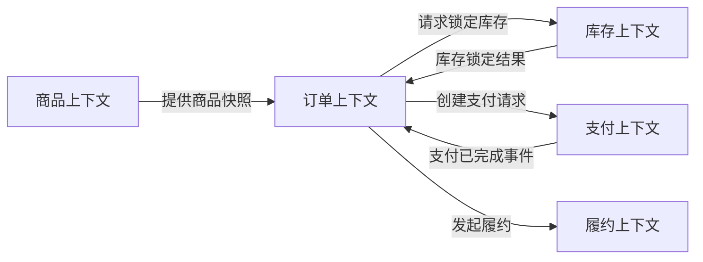

# 领域分析（战略 DDD）实践指南

领域分析的目标不是直接拆分微服务，而是让业务人员和技术人员共同还原一张完整的业务地图：谁在什么情况下、为了什么目标执行了什么动作，产生了什么业务结果，以及这个结果如何触发后续流程。

> [!abstract] 核心路径
> 先用领域事件还原真实业务，再补充命令、参与者和规则；随后从业务能力中识别子域，从语言和规则差异中划分限界上下文，最后描述上下文之间的协作关系。

推荐使用**大图事件风暴（Big Picture Event Storming）**开展分析，也可以使用具有相同表达能力的白板草图。

## 一、明确分析范围

开始前先写一句范围声明：

> 本次分析覆盖从「____」开始，到「____」结束，目标是理解「____」业务，暂不讨论具体技术实现。

例如：

> 本次分析覆盖从客户提交订单到订单完成，包括支付、履约和退款，暂不讨论数据库、接口和消息中间件设计。

范围应尽量覆盖一条端到端价值链。范围过大会导致讨论失控，范围过小则难以看清业务之间的连接。

## 二、组织参与人员

建议邀请以下角色参加：

- 领域专家：真正执行、制定或解释业务规则的人；
- 业务负责人或产品经理；
- 研发人员；
- 测试人员；
- 上下游系统负责人；
- 主持人：控制节奏、澄清术语并记录争议。

领域分析不能只由研发人员根据现有代码完成。代码只能反映当前实现，不一定能准确表达真实业务规则。

## 三、准备事件风暴白板

可以使用实体白板或在线协作白板，并统一便签颜色：

| 颜色 | 元素 | 含义 | 示例 |
| --- | --- | --- | --- |
| 橙色 | 领域事件 | 已经发生、对业务有意义的事实 | 订单已提交 |
| 蓝色 | 命令 | 用户或系统希望执行的动作 | 提交订单 |
| 黄色 | 参与者 | 发起命令的人员或角色 | 客户、审核员 |
| 紫色 | 策略 | 事件发生后自动触发的规则 | 支付成功后安排发货 |
| 绿色 | 查询信息 | 执行命令前需要查看的信息 | 可用库存、订单详情 |
| 粉色 | 热点问题 | 争议、风险或待确认事项 | 是否允许重复退款 |
| 红色 | 外部系统 | 不属于本业务控制范围的系统 | 支付平台、物流平台 |

便签应使用业务语言，避免写成技术实现。例如，应写“订单已提交”，而不是“订单表插入成功”或“MQ 消息已发送”。

## 四、第一轮：铺设领域事件时间线

第一轮只关注“发生了什么”，将领域事件按照业务发生时间从左到右排列。

```text
商品已选择
→ 订单已提交
→ 库存已锁定
→ 支付已完成
→ 订单已确认
→ 商品已发货
→ 商品已签收
→ 订单已完成
```

先追求业务覆盖面，不要过早争论实现细节。遇到不确定的问题，先贴上热点问题便签，再继续向后梳理。

可以依次追问：

1. 业务由什么事件开始？
2. 正常情况下接下来发生什么？
3. 哪些事件代表业务状态发生了有意义的变化？
4. 哪些结果会触发其他部门或系统继续处理？
5. 失败、取消、超时、撤回和驳回时会发生什么？

正常流程和异常流程都要覆盖，例如：

```text
支付已超时 → 订单已取消 → 库存已释放
付款已完成 → 退款已申请 → 退款已完成
```

## 五、第二轮：补充命令、参与者和查询信息

为每个领域事件找到触发它的命令，以及发起命令的参与者：

```text
客户 → 提交订单（命令）→ 订单已提交（领域事件）
```

分析每个命令时，需要回答：

- 谁发起这个动作？
- 发起动作时需要查看什么信息？
- 动作执行前必须满足什么条件？
- 成功和失败分别产生什么领域事件？
- 这是人工操作，还是由系统自动触发？

一个命令可能产生不同结果：

```text
订单已提交
→ 锁定库存
→ 库存已锁定 / 库存锁定失败
```

## 六、第三轮：补充策略和业务规则

在事件和后续命令之间补充自动化策略及业务约束：

```text
支付已完成
→ 若库存已锁定
→ 确认订单
→ 订单已确认
```

```text
订单已提交
→ 若超过 30 分钟仍未支付
→ 取消订单
→ 订单已取消
```

重点识别：

- 数据校验规则；
- 审批和权限规则；
- 状态流转条件；
- 时间和超时规则；
- 金额计算规则；
- 补偿、撤销和回退规则；
- 跨部门或跨系统协作规则。

业务描述中出现“只有……才能……”“如果……则……”“除非……”时，通常意味着存在需要显式建模的领域规则。

## 七、记录热点问题并建立统一语言

争议点不应被跳过。它们往往意味着隐藏的业务规则、概念冲突或潜在的模型边界，例如：

- “提交订单”和“确认订单”是否为同一个动作？
- 退款完成以支付平台受理为准，还是以资金到账为准？
- 一个订单是否允许分多次发货？
- “取消”和“关闭”有什么区别？
- 哪个部门拥有订单状态的最终解释权？

对关键术语给出业务定义，并在需求、代码、接口和测试用例中持续使用。例如：

| 术语 | 业务定义 |
| --- | --- |
| 提交 | 客户正式表达购买意图 |
| 确认 | 系统确认订单已满足履约条件 |
| 取消 | 由参与者主动发起的订单终止行为 |
| 关闭 | 订单已经终止且不能继续处理的最终状态 |

> [!warning] 不要为了统一而强行合并不同含义
> 如果同一个词在不同业务区域具有不同含义，应分别定义，并将这种语言差异作为识别限界上下文的重要线索。

## 八、归纳业务能力

将目标相近、规则相关的命令和事件聚合成业务能力，例如：

```text
商品管理、订单交易、库存管理、支付结算、履约配送、售后退款、客户管理
```

判断一组活动是否属于同一个业务能力，可以询问：

- 是否服务于同一个业务目标？
- 是否由同一类业务人员负责？
- 是否使用同一套业务规则？
- 是否具有相对独立的生命周期？
- 是否能够独立演进？

业务能力描述的是“企业能做什么”，此时不要直接把每项能力等同于一个微服务。

## 九、识别并分类子域

根据战略价值将业务能力归入三类子域：

| 子域类型 | 判断标准 | 投入策略 |
| --- | --- | --- |
| 核心子域 | 构成企业竞争优势或差异化能力 | 重点投入，精细建模，自主研发 |
| 支持子域 | 支撑核心业务，但不形成竞争优势 | 保持适用和可维护 |
| 通用子域 | 行业内已有成熟通用方案 | 优先采购、复用或采用标准方案 |

分类依据是业务战略价值，而不是技术难度。例如，物流企业的智能调度可能是核心子域，而用户认证、文件存储通常是通用子域。

## 十、识别限界上下文候选

在业务地图上寻找语言和模型的边界。常见信号包括：

- 同一个术语在不同区域具有不同含义；
- 不同区域由不同业务团队负责；
- 业务目标、规则或变化频率明显不同；
- 数据生命周期和一致性要求不同；
- 某一区域能够相对独立地完成业务目标。

例如，“商品”在不同上下文中可能代表不同模型：

| 上下文 | “商品”所关注的信息 |
| --- | --- |
| 商品上下文 | 名称、分类、规格、图片 |
| 订单上下文 | 成交价、购买数量、优惠快照 |
| 库存上下文 | SKU、可用量、锁定量 |
| 履约上下文 | 重量、体积、配送要求 |

因此可以得到商品、订单、库存和履约等限界上下文候选。限界上下文首先是模型和语言的一致性边界，不等同于最终的微服务部署边界。

## 十一、绘制上下文映射

明确限界上下文之间如何协作：



每条连接至少要说明：

- 上游和下游分别是谁；
- 传递的是命令、查询结果还是领域事件；
- 哪个上下文拥有数据和业务规则；
- 是否要求实时一致；
- 调用失败后如何处理；
- 是否需要通过防腐层转换模型。

必要时标记战略 DDD 中的上下文关系：

- **客户—供应商（Customer–Supplier）**：上下游协商契约；
- **遵奉者（Conformist）**：下游直接接受上游模型；
- **防腐层（Anti-Corruption Layer）**：下游转换外部模型，保护自身领域语言；
- **开放主机服务 + 已发布语言**：上游提供稳定、公开的集成协议；
- **共享内核（Shared Kernel）**：双方共同维护少量模型，应谨慎使用；
- **各行其道（Separate Ways）**：双方无须集成，各自独立演进。

## 十二、形成分析交付物

领域分析结束后，至少应产出：

1. 端到端业务事件地图；
2. 正常流程和主要异常流程；
3. 命令、参与者、业务规则与领域事件清单；
4. 统一语言词汇表；
5. 业务能力清单；
6. 核心子域、支持子域和通用子域分类；
7. 限界上下文候选清单；
8. 上下文映射图；
9. 业务争议点和待确认事项；
10. 每个上下文的职责与边界说明。

限界上下文清单可以使用以下模板：

| 限界上下文 | 核心职责 | 关键概念 | 输入 | 输出事件 | 上游/下游 |
| --- | --- | --- | --- | --- | --- |
| 订单 | 管理交易生命周期 | 订单、订单项 | 提交订单 | 订单已提交 | 商品、库存、支付 |
| 库存 | 管理库存数量与占用 | 库存、锁定记录 | 锁定库存 | 库存已锁定 | 订单 |
| 支付 | 管理支付与退款 | 支付单、退款单 | 发起支付 | 支付已完成 | 订单、支付平台 |

## 十三、验收检查清单

- [ ] 能够从业务起点完整讲述到最终业务结果；
- [ ] 已覆盖正常流程和主要异常流程；
- [ ] 每个关键事件都能说明由谁、因为什么动作产生；
- [ ] 状态流转、校验、时间和补偿规则已经显式记录；
- [ ] 关键业务术语具有明确含义；
- [ ] 未解决的概念歧义和业务争议均已记录责任人；
- [ ] 每项关键数据和规则都有明确的业务所有者；
- [ ] 子域分类能够用业务战略价值解释；
- [ ] 每个限界上下文的职责和边界清晰；
- [ ] 上下文之间传递什么、为什么连接、失败后如何处理已经明确；
- [ ] 领域专家确认分析结果符合真实业务。

只有在上述领域边界基本稳定之后，才进入聚合设计和微服务边界识别。后续方法参见 [[微服务划分规范]]。

## 相关笔记

- [[微服务划分规范]]
- [[DDD 中的实体与值对象]]
