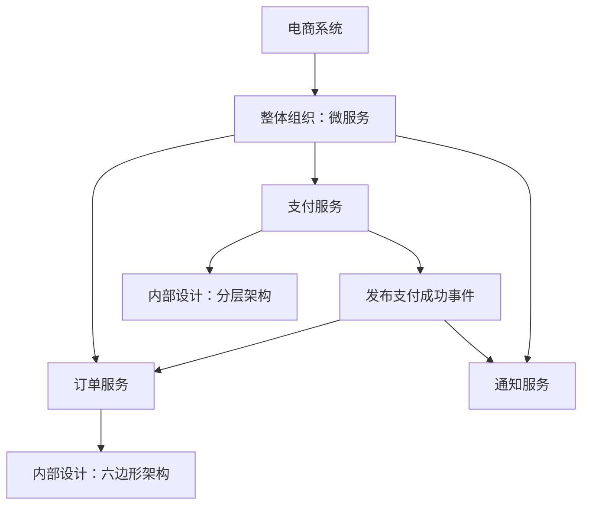

# 软件系统架构分类与常见架构风格

## 一、架构一共分为几种

软件系统架构没有统一的“总共几种”。讨论架构时，需要先说明分类维度：是在描述系统的不同关注面，还是在讨论系统的组织方式、依赖规则和通信模式。

按关注面理解，可以从业务架构、应用架构、数据架构、技术架构、部署架构和安全架构六个方面入手。按架构风格理解，则会遇到分层、单体、微服务、事件驱动、微内核、六边形架构等概念。

> [!important] 六类是学习框架，不是统一标准
> 不同组织和方法论的分类不同。例如，有的把部署、安全归入技术架构，有的单独讨论集成架构或运维架构。业务架构也常用于企业架构层面的讨论，范围可能超过某一个软件系统。

## 二、按关注面划分：六个常见架构视角

### 业务架构：系统为什么建，要支持哪些业务

业务架构关注业务目标、业务能力、业务流程，以及角色和职责之间的关系。它帮助团队先明确业务边界，再讨论软件如何实现。

以电商为例，需要说明商品管理、交易、支付、售后等业务能力，以及从用户下单到订单履约的流程。业务能力不必与服务一一对应，一个能力可以由多个应用协作实现。

### 应用架构：系统由哪些应用组成，如何协作

应用架构关注应用或服务的职责划分、边界、依赖关系和交互方式。

以电商为例，可以设计用户、商品、订单和支付等服务，明确订单服务如何发起支付、支付结果如何反馈，以及哪些能力由外部系统提供。拆分时需要考虑业务边界、团队协作、独立发布和维护成本。

### 数据架构：数据如何组织、存储和流转

数据架构关注数据模型、数据归属、存储分布、共享方式、生命周期和一致性要求。

以电商为例，需要确定订单与订单明细如何建模，订单数据由哪个服务维护，交易数据如何进入分析平台，以及敏感数据如何保留和清理。分库分表、数据仓库和数据同步都可能涉及数据架构，但是否采用取决于实际需求。

### 技术架构：用哪些技术机制支撑系统

技术架构关注框架、中间件、基础平台及其协作方式，并说明这些选择如何满足性能、可用性、扩展性和可维护性要求。

例如，使用 Spring Boot 实现后端服务，Redis 支撑缓存，Kafka 承载异步消息。技术架构还需要解释缓存失效、消息重试、超时和故障隔离等机制，不能只停留在技术名称的罗列。

### 部署架构：软件如何映射到运行环境

部署架构关注应用实例、服务器、容器、网络、可用区和地域之间的分布关系，以及流量如何进入系统、故障后如何恢复。

例如，通过负载均衡访问多个服务实例，将数据库配置为主备，并在不同可用区部署关键组件。部署多个实例并不自动等于高可用，还需要检查数据库、网络、共享存储等依赖是否存在单点故障。

### 安全架构：如何保护身份、权限和数据

安全架构关注身份认证、访问授权、信任边界、数据保护、安全审计和威胁应对。

例如，通过单点登录确认用户身份，通过角色和数据权限控制访问范围，对敏感数据加密或脱敏，并记录关键操作。安全要求会影响应用接口、数据存储和部署网络，是贯穿系统的关注面。

## 三、按组织方式和设计规则理解常见架构风格

### 单体架构与微服务架构：应用如何交付和部署

单体架构通常将主要业务功能作为一个整体构建和部署。它的初期交付与运维相对简单，也可以通过清晰的模块边界形成模块化单体，适合业务规模、团队规模和发布要求相对集中的场景。

微服务架构将系统划分为多个围绕业务能力组织、可独立部署的服务。它有助于独立演进和按需扩容，同时增加网络通信、分布式一致性、可观测性及运维治理的成本。

选择时需要结合实际需求：业务边界是否清晰、是否存在独立发布或扩容诉求，以及团队是否具备分布式系统治理能力。微服务并不是所有系统必经的演进阶段。

### 分层架构：应用内部如何划分职责

分层架构按职责组织代码，常见划分包括表现层、业务层和数据访问层。在常见的严格分层设计中，上层通过下层提供的接口访问能力，减少跨层调用。

例如，Controller 接收请求，Service 处理业务，Repository 或 Mapper 负责数据访问。分层适用于单体，也适用于单个微服务内部；仅有这些目录名称，还不足以保证职责边界清晰。

### 六边形架构：业务核心如何与外部技术隔离

六边形架构，也称端口与适配器架构，通过端口定义业务核心需要或提供的交互能力，通过适配器连接 HTTP、数据库、消息系统等外部设施。

例如，业务核心定义订单存储端口，数据库适配器实现该端口。业务核心在代码依赖上无需直接依赖具体数据库实现，有助于测试业务规则以及替换外部设施。

它主要约束应用内部的边界与依赖方向，可以用于单体，也可以用于微服务。

### 事件驱动架构：组件之间如何传播业务变化

事件驱动架构通过事件表达已经发生的事实，由感兴趣的组件消费并处理。

例如，订单服务发布“订单已支付”事件，积分和通知组件分别处理后续业务。该方式有助于降低同步调用耦合，但需要处理重复消费、消息顺序、失败重试、事件版本和最终一致性。

事件驱动既可以用于单体内部，也可以用于多个服务之间。使用消息队列是实现手段之一，系统中出现消息队列并不意味着整体采用了事件驱动架构。

### 微内核架构：如何围绕稳定核心扩展功能

微内核架构由稳定的核心和可扩展插件组成。核心提供基本能力与扩展协议，插件承载可变化的功能，常用于 IDE、规则平台或具有明确扩展需求的产品。

例如，开发工具的核心提供编辑和插件加载能力，语言插件补充语法分析、代码提示和调试功能。设计重点在于扩展接口、兼容性及插件隔离。

## 四、为什么这些架构可以组合使用

上述概念回答的问题不同，不能全部放在同一个维度上进行互斥选择。一个系统可以在整体上采用微服务，每个服务内部采用分层或六边形架构，部分业务通过事件协作。

图中“微服务”描述整体的服务组织方式，“分层”和“六边形”描述服务内部设计，“事件驱动”描述部分服务间的协作方式。部署架构还可以进一步说明这些服务的实例、网络和容灾安排。

## 五、用一个业务场景串联六个视角

以电商支付为例，业务架构定义下单、支付和履约的流程及职责；应用架构确定订单、支付和通知服务如何协作；数据架构明确订单、支付流水和事件数据的归属及一致性要求。

技术架构选择服务框架、消息设施与重试机制；部署架构安排服务实例、入口流量和故障切换；安全架构明确支付回调验签、访问控制、敏感数据保护与审计要求。

这些设计共同描述同一个系统，各视角之间需要保持一致。例如，业务上要求“支付成功后订单最终更新”，就需要应用协作、数据一致性和消息故障恢复机制共同支撑。

## 六、学习与阅读架构文档的方法

学习时可以先理解业务、应用、数据、技术、部署和安全分别关注什么，再理解单体与微服务的组织方式，随后深入应用内部设计和事件协作。

阅读架构方案时，先确认它在回答什么问题，再看边界、依赖和取舍。例如，“采用微服务”需要说明为什么拆分、拆成哪些服务以及如何治理；“采用 Redis”需要说明解决什么问题以及故障时如何处理。

架构设计的价值在于解释关键决策及其代价，并使系统满足具体业务和质量要求。

## 延伸阅读

关于业务边界与服务划分，可继续阅读[领域分析（战略 DDD）实践指南](../微服务/领域分析（战略%20DDD）实践指南.md)和[微服务划分规范](../微服务/微服务划分规范.md)。
